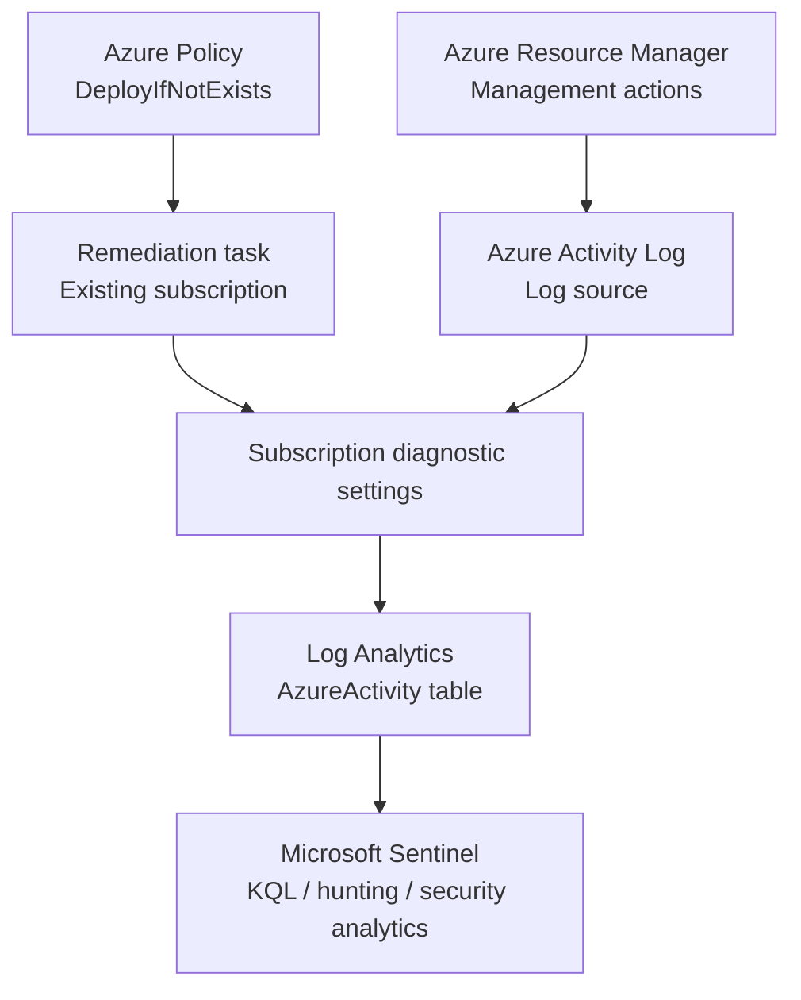
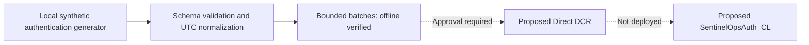

# SentinelOps MXDR

**Microsoft Sentinel platform-engineering lab**

> **19 October 2026 - Twelve managed detections deployed disabled.** Ten additional AzureActivity definitions now have actual OIDC/REST verification and investigation runbooks. Existing Fusion remains enabled; subscription and workspace settings are preserved. Phase 4 offline correlation remains implemented. See [PROJECT_STATUS.md](docs/PROJECT_STATUS.md); disabled rules do not provide active alerting.

> **28 October 2026 - Personal local Linux machine added to the lab.** A dedicated Ubuntu VM, local verification tooling and a fixed Arc/AMA Syslog design now extend the documented lab. The operator approved only one bounded cloud pilot; execution and actual ingestion evidence remain separate acceptance stages. See the [onboarding runbook](docs/onboarding/local-linux-ama.md) and [validation](docs/validation/local-linux-ama.md).

This technical lab covers SIEM platform deployment, source onboarding, troubleshooting, KQL investigations and ingestion-health validation. The documented environment is a lab, not a production deployment.

## Proven deliverables

| Engineering capability | Evidence |
|---|---|
| Microsoft Sentinel on Log Analytics (West Europe) | [Azure resource inventory](evidence/01-azure-resources.png) |
| Azure Activity solution and connector configured | [Connector inventory](evidence/02-azure-activity-connector.png) |
| Azure Policy `DeployIfNotExists` assigned | [Policy parameters](evidence/03-azure-policy-assignment.png) |
| Existing subscription remediated: **1/1 resources** | [Remediation result](evidence/04-remediation-complete.png) |
| Subscription-level diagnostic export to workspace | [Diagnostic setting](evidence/05-diagnostic-settings.png) |
| Activity events queryable with KQL | [Query result](evidence/06-kql-ingestion-summary.png) |
| Operations analysis and estimated ingestion latency | [Operations](evidence/07-kql-administrative-operations.png) · [Latency](evidence/08-kql-ingestion-latency.png) |

**Observed snapshot:** 9 records, 3 distinct `Caller` values; mean estimated ingestion delay 7.89 min, maximum 9 min. These are *point-in-time lab observations*, **not** production performance targets or SLAs. The connector inventory itself shows a neutral Azure Activity status, so correctness is established through the diagnostic export and actual `AzureActivity` table results, not by assuming the connector UI is green.

## Data flow



Azure Policy **governs and deploys configuration**, rather than forwarding event payloads itself. Diagnostic settings export Azure Activity to Log Analytics. Sentinel queries the ingested data. Learn more in the [architecture overview](docs/architecture/overview.md).

## Getting started

1. Follow the [manual deployment record](docs/deployment/azure-sentinel-setup.md).
2. Review the [Azure Activity onboarding runbook](docs/onboarding/azure-activity.md).
3. Read the [Azure Policy remediation incident](docs/troubleshooting/azure-policy-remediation.md).
4. Run the reusable [KQL queries](hunting/) against a workspace containing `AzureActivity`.
5. Review [validation evidence](docs/validation/first-ingestion.md) and the [roadmap](docs/roadmap.md).
6. Review [AZ-DET-001](docs/detections/AZ-DET-001.md), the [CI/CD prerequisites and runbook](docs/deployment/detection-cicd.md), [pipeline troubleshooting](docs/troubleshooting/detection-cicd.md) and [deployment evidence status](docs/validation/detection-cicd.md).

Run the dependency-free offline checks with Python 3.12+:

```powershell
python -m scripts.validate_detection
python -m unittest discover -s tests -v
python -m ingestion
python -m scripts.assess_detections
python -m platform_health
python -m rba
python -m portfolio
python -m ama
```

The primary pipeline updates only the configured existing disabled rule through GitHub OIDC. It stops before authentication if prerequisites are missing. It never selects another subscription, provisions paid infrastructure or enables a rule. Optional live validation is manual and returns only aggregates. See [AGENTS.md](AGENTS.md) for permanent project constraints.

The operator also authorized [AZ-DET-002 - Azure Role Assignment Created](docs/detections/AZ-DET-002.md), now deployed disabled through its fixed-target workflow using the same existing identity. [Setup and scope](docs/deployment/detection-cicd.md), [security](docs/security.md), [reusable templates](templates/) and [actual Azure evidence](docs/validation/platform-setup.md) document the implementation. No paid service, connector or billing change was introduced.

## Detection portfolio before SOAR

The [AzureActivity portfolio](docs/detections/portfolio.md) adds ten reviewed disabled definitions for custom roles, network rules, Key Vault access policies, VM Run Command, storage key listing, removed locks/alerts/policies, repeated failed privileged operations and ordered role-grant/diagnostic changes. All reuse the existing source. Each has synchronized KQL/REST, investigation guidance, benign matches, MITRE/coverage limitations and original-event lineage. Disabled definitions do not provide active coverage.

`python -m portfolio` checks complete fixed contracts and 60 synthetic controls; 130 tests pass. The [successful main OIDC deployment](https://github.com/miguelcastu/SentinelOps-MXDR/actions/runs/39235924991) verified all ten additional disabled definitions after a fingerprint-bound approval and exact target-scoped permissions using the existing identity. [Validation and actual deployment evidence](docs/validation/detection-portfolio.md) distinguish source agreement from runtime/accuracy evidence; no new source, activation, incident, paid resource or subscription change is included.

## Advanced ingestion: offline implementation

The fictional **Atlas Financial** customer now has a second source format: explicitly synthetic Windows-style authentication. The dependency-free Python pipeline generates stable IDs, validates its schema, normalizes UTC timestamps and ASIM-shaped fields, and prepares bounded batches. Its real HTTPS transport has finite retries, rate limits, no redirects, sanitized errors and explicit approval before network access; HTTP behavior is tested with mocks. The offline CLI makes zero Azure calls.



[Source inventory](ingestion/sources.json), [onboarding](docs/onboarding/synthetic-authentication.md), [REST bodies](infrastructure/ingestion/) and [cost/validation evidence](docs/validation/phase-1-2.md) document the implementation. The default demo produces 24 events and a 14,833-byte batch. No DCR/table or ingestion workload was created. [Synthetic triage and the incident proposal](docs/detections/lifecycle-validation.md) record benign matches and coverage gaps without claiming real-data false-positive statistics.

## Personally owned Linux machine and AMA

The [local Linux source](ama/source.json) uses a dedicated VirtualBox Ubuntu 24.04 guest on the operator's personal PC, avoiding Azure compute. It has NAT, loopback-only SSH, key authentication and no shared folders. Preview-first preparation, a hash-pinned local Arc package installer and sanitized SSH verification are versioned; images, keys and raw diagnostics remain ignored. Existing VMs and Windows security settings are preserved.

The [runbook](docs/onboarding/local-linux-ama.md) explains rsyslog -> AMA -> the existing workspace's `Syslog` table, Arc's separate management role, the exact DCR/extension/association and the manual acceptance sequence. The approved pilot collects only `local4` Warning and above with ten labeled messages; it does not collect native SSH authentication or university tenant logs. A fingerprint-bound main-only OIDC workflow configures only the three fixed targets. The manual local sender has a persistent attempt ledger and bounded aggregate verification; there is no GitHub sender or schedule. [Validation](docs/validation/local-linux-ama.md) separates local VM readiness, mock-tested deployment and actual cloud acceptance, including possible ingestion charges. Rule activation remains outside this scope.

## Platform health and observability

[Health tooling](platform_health/) evaluates Healthy, Delayed, Missing, Misconfigured and Unknown states using the existing inventory. It handles stale/partial evidence, latency, missing approved batches, schema/mapping errors, duplicates, rule/workspace drift, latest deployment failures and partial ingestion-cost estimates. Quiet AzureActivity has no heartbeat requirement, so zero events alone never proves a collection failure.

`python -m platform_health` runs eleven synthetic scenarios and writes JSON, Markdown and a standalone filterable dashboard under `.local/platform-health/`. The default demonstration performs no network calls. The manual **Read-only Platform Health** GitHub workflow reuses existing OIDC permissions to inspect workspace/rule configuration and workflow history; it executes no KQL or recurring workload. Configuration agreement is separate from active detection coverage and actual ingestion/runtime health.

The [actual OIDC health audit](https://github.com/miguelcastu/SentinelOps-MXDR/actions/runs/39153342114) succeeded: workspace and both managed rule configurations match, and latest observed validation/deployment runs passed. Overall health remains **Unknown** because telemetry/export/runtime were not measured; this is distinct from a failed audit. [Sanitized evidence](evidence/phase-3/health-report.sanitized.json) and [synthetic fault outcomes](evidence/phase-3/fault-injection.sanitized.json) are separate.

See the [health runbook and SLIs](docs/operations/platform-health.md), [KQL library](platform_health/queries/) and [validation evidence](docs/validation/phase-3.md). No SentinelHealth export, resources or roles were added.

## Risk-based correlation: synthetic investigation

[Offline RBA](rba/) scores canonical account entities across synthetic authentication, AzureActivity-shaped administration and endpoint-style signals. AF-RBA-001 requires strict event order, same-account/host/resource relationships, at least three families and enough accumulated risk. Individual weak signals and duplicate replays cannot independently produce the demonstrated finding. Uncertainty about collection limits confidence without suppressing valid evidence.

`python -m rba` writes an interactive entity/timeline replay, JSON contribution ledger, original synthetic dataset and investigation Markdown to `.local/rba/`. The default scenario produces one High-priority/Low-confidence synthetic finding with a 75.7182 peak; maintenance and administrative-noise controls remain below threshold. Nine scenarios cover joins, order, duplicates and benign controls. It executes no payload, network request, KQL or Azure operation and creates no Sentinel incident.

See the [scoring design and investigation runbook](docs/operations/risk-correlation.md), [validation](docs/validation/phase-4.md) and [versioned signal contract](schemas/rba-signal.schema.json). This lab demonstrates heuristic correlation, not calibrated probabilities or measured production accuracy.

## Project organization

```text
docs/         Architecture, onboarding, deployment, validation, troubleshooting
hunting/      Reusable KQL queries
evidence/     Sanitized Azure records and explicitly labeled synthetic evidence
infrastructure/  Proposed ingestion REST bodies; platform Bicep remains future work
ingestion/    Synthetic generator, normalization, bounded client and source inventory
ama/          Planned owned Linux source, fixed AMA contract, bounded pilot and aggregate KQL
platform_health/  Source health, readonly collector, local reports, safe faults and KQL library
rba/          Synthetic entity risk, correlation, baselines, source adapters and replay reports
tests/        Lightweight offline project validation
detections/azure/  Disabled REST rule definition and synchronized KQL
schemas/      Signal/source contracts and restricted approved-rule JSON Schema
scripts/      Offline validation, guarded deployment and aggregate queries
.github/workflows/  Free public-repository CI, OIDC deployment and opt-in KQL checks
```

## Costs and privacy

Azure budgets are alerts, **not hard spending limits**. Promotional credit and product trials are subject to eligibility and expiration. Verify charges, Log Analytics ingestion, retention and workspace caps in your own subscription. Do not include secrets, tenant/subscription IDs, email identities or unredacted event logs. See [evidence guidelines](docs/evidence-handling.md).

Keep the existing subscription and billing plan. Azure reports a 200 USD / 175.99 EUR sign-up credit expiring 12 November 2026 at 18:00 UTC. The credit API reports no charges in available events; billing lag can apply. No paid service or chargeable experiment was introduced. Existing Azure resources can still accrue their own costs. See [billing and preservation evidence](docs/validation/platform-setup.md).

## Status / roadmap

- [x] Azure foundation, source onboarding, policy remediation and working Azure Activity ingestion evidence.
- [x] Exact-resource RBAC, MFA-protected initial setup, immutable GitHub OIDC and protected PR validation.
- [x] Two disabled detections, synthetic cases, actual deployment/REST verification and a clean manual drift check.
- [x] Ingestion offline: synthetic source, normalization, bounded transport, configuration and tests.
- [ ] Approved DCR/table deployment, one upload and destination verification for a second cloud source.
- [x] Personal local Linux VM preparation, verification and documented Arc/AMA source design.
- [ ] Approved Arc/AMA registration, exact cloud configuration and reconciled Syslog pilot.
- [ ] Live telemetry false-positive measurement, activated alert behavior and investigations.
- [x] Platform health evaluator, local dashboard, eleven safe faults and manual read-only OIDC audit tooling.
- [x] Offline entity risk correlation, strict attack sequence, baseline controls and replay report.
- [ ] SOAR, platform Bicep and operational handover.
