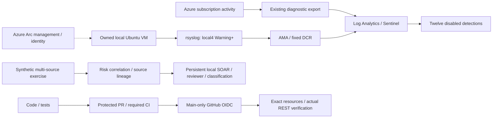

# SentinelOps MXDR

**Microsoft Sentinel engineering, detection as code and controlled SOC automation.**

A reproducible security-engineering portfolio for **Atlas Financial**, a fictional
customer. It combines actual Azure/OIDC deployment evidence with a complete
offline lab: source normalization, detection controls, telemetry health, risk
correlation, persistent case handling, reviewer decisions and customer delivery.

> **3 November 2026:** the original Azure subscription is Enabled with spending
> limit On. Twelve managed detections remain disabled; the owned Linux AMA VM
> is stopped. SOAR, Bicep models, AMA health policies, customer operations and
> the integrated demonstration are implemented. The original mission's real
> scheduled-alert/incident closure remains a separately gated acceptance test.
> [Exact status and evidence](docs/PROJECT_STATUS.md).

## Try it in one command

Python **3.12+**, Git and a checkout of this public repository are sufficient.
The default lab needs no Azure login, Python dependencies, hosted service or
paid account. It performs no network request or cloud operation.

```powershell
python -m lab --bundle
```

Open **`.local/lab/index.html`**. Explore the detection catalog, source-health
faults, original event timeline, correlated finding, reviewer-gated closed case
and actual cloud evidence. A portable ZIP with source, workflows, reports and
a SHA-256 manifest is created beside the output. Private pins, credentials,
VM disks and the case database are excluded. The demonstration keeps working
after the Azure account is closed.

[Architecture and evidence overview](docs/architecture/overview.md)



Cloud source proofs are point-in-time observations. The SOAR exercise is local
and synthetic; it does not create a Sentinel incident. Arc manages one owned
guest; it does not export university directory logs or join the device to Entra.


## What is implemented

| Capability | Executable implementation | Evidence and practical limit |
|---|---|---|
| Detection engineering | Twelve fixed AzureActivity rules, synchronized KQL/REST, entity mapping, investigations and sixty portfolio controls | [Actual disabled deployment](docs/validation/detection-portfolio.md); no active security coverage or measured production false-positive rate |
| Source onboarding | AzureActivity export; actual owned Linux Arc/AMA pilot; synthetic auth schema/normalizer/bounded transport | [10/10 AMA messages, 2,600 billable bytes](docs/validation/local-linux-ama.md); guest stopped, native SSH outside collection |
| Platform health | Three-source policies, freshness/quality/latency/volume checks, sixteen safe fault scenarios and maintenance handling | [Operations and SLIs](docs/operations/platform-health.md); unavailable telemetry remains Unknown |
| Risk correlation | Canonical identity joins, event lineage, ordered attack sequence, bounded scoring/decay/caps, deduplication and nine scenario controls | [Design and replay](docs/operations/risk-correlation.md); synthetic finding, not a calibrated risk probability |
| SOAR | Durable SQLite cases, structured notes, enrichment, revision/expiry-bound reviewer decisions, classified closure, idempotent local ticket and chained audit | [Implementation and six failure scenarios](docs/operations/soar.md); local roles/connectors are simulations |
| IaC and recovery | Four Bicep models, one parameter file, pinned compiler, nineteen-target comparison and destructive-change gates | [Real compilation](docs/validation/phase-6.md); full platform ARM deployment/what-if remains unverified |
| Customer operations | Twenty deliverables, definition-derived coverage, RACI, runbooks, SLIs, risk register and eight fictional service tickets | [Atlas Financial handover](customer/atlas-financial/README.md); no real customer or affiliation claim |
| Portfolio delivery | One-command integrated replay, standalone evidence explorer, portable archive and presentation/interview material | [Reviewer guide](docs/portfolio/README.md) and [final acceptance](docs/validation/project-completion.md) |

The [isolated synthetic scheduler test](docs/deployment/synthetic-lifecycle.md)
is implemented with a fixed target, twenty-minute data expiry, finite polling,
mandatory disable and exact-incident classification. Its code and mock checks
are **not actual alert/incident evidence**; the live gate remains explicit.

## Verify the project

```powershell
python -m unittest discover -s tests -v
python -m scripts.validate_detection
python customer/atlas-financial/validate.py
python -m portfolio
python -m platform_health
python -m rba
python -m soar
python -m infrastructure.preview
python -m lab --bundle
```

Current local suite: **187 tests**, plus independent customer/evidence/schema
checks. Required GitHub CI runs on Python 3.12; local checks also run on 3.15.
The pinned Bicep compiler is acquired from the official release, SHA-256 checked
and actually executed in CI. Tests cover conflicting replay, lineage, approval
expiry, audit corruption, persistent retry budgets, partial/stale health,
forbidden infrastructure changes, exact resource contracts and archive privacy.
These checks are separate from actual Kusto/REST evidence.

Component demos write only ignored `.local/` artifacts. The integrated risk
finding is passed directly into SOAR with its original seven-event chain.
The separate 24-event normalization sample is labeled as a distinct fixture;
the project does not pretend it caused an unrelated real Azure incident.

## Actual cloud evidence

| Observation | Recorded result |
|---|---|
| [AzureActivity ingestion](docs/validation/first-ingestion.md) | Actual KQL arrival and policy/export troubleshooting; historical snapshot |
| [Detection OIDC deployment](https://github.com/miguelcastu/SentinelOps-MXDR/actions/runs/39235924991) | Twelve total managed Scheduled definitions disabled; existing Fusion preserved |
| [AMA main OIDC verification](https://github.com/miguelcastu/SentinelOps-MXDR/actions/runs/40774219658) | Same fixed DCR/extension/association already matching after approved one-time initialization |
| [Actual Syslog query](evidence/local-linux-ama/ingestion.sanitized.json) | Ten total/ten distinct messages, two aggregate queries, 900 payload bytes and 2,600 billable bytes |
| [Fresh 3 November baseline](evidence/completion/baseline.sanitized.json) | Thirteen rules, twelve disabled Scheduled, original Fusion enabled, eighteen CI assignments, Arc Disconnected |
| [Subscription/credit](evidence/completion/eligibility.sanitized.json) | Same Enabled subscription, spending limit On, published EUR175.99436818021823; expiry 12 November 2026 18:00:16 UTC |

Raw logs, identity fields and subscription/tenant identifiers are not release
artifacts. Cloud records remain dated evidence, not a promise the subscription
will still exist when someone clones the repository. See [evidence handling](docs/evidence-handling.md).

## Security and cost design

The control path is **feature branch -> protected PR -> required CI -> merged
main -> approved environment -> short-lived OIDC -> exact-resource REST ->
read-back**. PR validation has no Azure credentials/OIDC permission. The
existing CI identity and immutable repository/environment trust are reused;
actions and the compiler are pinned. No client secret or public SSH endpoint.
See [security boundaries](docs/security.md) and [recovery](docs/deployment/recovery.md).

The subscription and plan are preserved. Workspace pricing `pergb2018`,
30-day retention, 0.1 GB/day cap, budgets and diagnostics are unchanged.
The operator permits a maximum EUR175 for necessary completion work; the
offline implementation uses **zero additional Azure ingestion or paid services**.
Available credit is not a spending target. Closed credit can lag charges;
2,600 historical billable bytes are not a measured invoice or zero-cost proof.
No Azure VM, paid add-on, Defender plan, university source or recurring sender.

## Review and demonstrate

- [Five-minute demo](docs/portfolio/demo-five-minutes.md) and [fifteen-minute presentation](docs/portfolio/presentation-fifteen-minutes.md).
- [Engineering decisions](docs/portfolio/engineering-decisions.md) and [troubleshooting cases](docs/portfolio/engineering-case-studies.md).
- [Interview and CV wording](docs/portfolio/interview-and-cv.md).
- [Customer package](customer/atlas-financial/README.md), [acceptance/limitations](docs/validation/project-completion.md), [operator-led account closure](customer/atlas-financial/handover.md).

## Repository map

```text
lab/                  Integrated replay, evidence explorer and portable release
detections/azure/     Twelve disabled REST/KQL definitions
portfolio/            Exact contracts and sixty synthetic controls
ingestion/            Synthetic event schema, normalization and bounded transport
ama/                  Actual pilot source, fixed AMA contract and aggregate KQL
platform_health/      Source policies, safe faults, metadata collector and reports
rba/                  Canonical risk/sequence engine and original-event lineage
soar/                 Persistent local case workflow, approvals and audit
infrastructure/       Bicep models, compiler lock and nonmutating preview
lifecycle/            Isolated approval-gated real-scheduler test contract
customer/atlas-financial/  Operational delivery, coverage and fictional tickets
docs/                 Architecture, runbooks, validation and portfolio material
evidence/             Sanitized actual records and labeled synthetic evidence
.github/workflows/    Required offline CI and manual scoped OIDC operations
tests/                Unit, behavior, security and integration checks
```

This is an engineering lab with explicit acceptance boundaries, not a deployed
production MXDR service. Preserve those boundaries when presenting the project.
