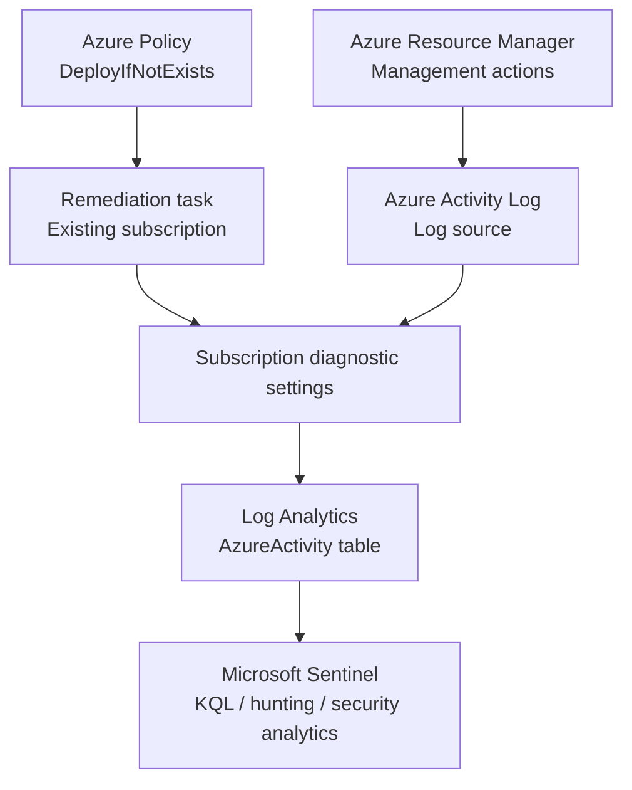
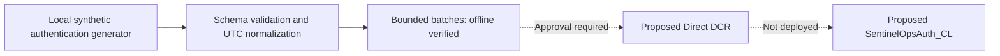

# SentinelOps MXDR

**Microsoft Sentinel platform-engineering lab**

> **18 October 2026 - Phase 3 platform health implemented.** Source-specific health evaluation, safe fault injection, local reports and a manual read-only OIDC audit are implemented. The two managed detections remain intentionally disabled; live telemetry queries and a second cloud source still need approval. Resume from [PROJECT_STATUS.md](docs/PROJECT_STATUS.md).

This technical lab covers SIEM platform deployment, source onboarding, troubleshooting, KQL investigations and ingestion-health validation. The documented environment is a lab, not a production deployment.

## Proven deliverables

| Engineering capability | Evidence |
|---|---|
| Microsoft Sentinel on Log Analytics (West Europe) | [Azure resource inventory](evidence/01-azure-resources.png) |
| Azure Activity solution and connector configured | [Connector inventory](evidence/02-azure-activity-connector.png) |
| Azure Policy `DeployIfNotExists` assigned | [Policy parameters](evidence/03-azure-policy-assignment.png) |
| Existing subscription remediated: **1/1 resources** | [Remediation result](evidence/04-remediation-complete.png) |
| Subscription-level diagnostic export to workspace | [Diagnostic setting](evidence/05-diagnostic-settings.png) |
| Activity events queryable with KQL | [Query result](evidence/06-kql-ingestion-summary.png) |
| Operations analysis and estimated ingestion latency | [Operations](evidence/07-kql-administrative-operations.png) · [Latency](evidence/08-kql-ingestion-latency.png) |

**Observed snapshot:** 9 records, 3 distinct `Caller` values; mean estimated ingestion delay 7.89 min, maximum 9 min. These are *point-in-time lab observations*, **not** production performance targets or SLAs. The connector inventory itself shows a neutral Azure Activity status, so correctness is established through the diagnostic export and actual `AzureActivity` table results, not by assuming the connector UI is green.

## Data flow



Azure Policy **governs and deploys configuration**, rather than forwarding event payloads itself. Diagnostic settings export Azure Activity to Log Analytics. Sentinel queries the ingested data. Learn more in the [architecture overview](docs/architecture/overview.md).

## Getting started

1. Follow the [manual deployment record](docs/deployment/azure-sentinel-setup.md).
2. Review the [Azure Activity onboarding runbook](docs/onboarding/azure-activity.md).
3. Read the [Azure Policy remediation incident](docs/troubleshooting/azure-policy-remediation.md).
4. Run the reusable [KQL queries](hunting/) against a workspace containing `AzureActivity`.
5. Review [validation evidence](docs/validation/first-ingestion.md) and the [roadmap](docs/roadmap.md).
6. Review [AZ-DET-001](docs/detections/AZ-DET-001.md), the [CI/CD prerequisites and runbook](docs/deployment/detection-cicd.md), [pipeline troubleshooting](docs/troubleshooting/detection-cicd.md) and [deployment evidence status](docs/validation/detection-cicd.md).

Run the dependency-free offline checks with Python 3.12+:

```powershell
python -m scripts.validate_detection
python -m unittest discover -s tests -v
python -m ingestion
python -m scripts.assess_detections
python -m platform_health
```

The primary pipeline updates only the configured existing disabled rule through GitHub OIDC. It stops before authentication if prerequisites are missing. It never selects another subscription, provisions paid infrastructure or enables a rule. Optional live validation is manual and returns only aggregates. See [AGENTS.md](AGENTS.md) for permanent project constraints.

The operator also authorized [AZ-DET-002 - Azure Role Assignment Created](docs/detections/AZ-DET-002.md), now deployed disabled through its fixed-target workflow using the same existing identity. [Setup and scope](docs/deployment/detection-cicd.md), [security](docs/security.md), [reusable templates](templates/) and [actual Azure evidence](docs/validation/platform-setup.md) document the implementation. No paid service, connector or billing change was introduced.

## Advanced ingestion: offline implementation

The fictional **Atlas Financial** customer now has a second source format: explicitly synthetic Windows-style authentication. The dependency-free Python pipeline generates stable IDs, validates its schema, normalizes UTC timestamps and ASIM-shaped fields, and prepares bounded batches. Its real HTTPS transport has finite retries, rate limits, no redirects, sanitized errors and explicit approval before network access; HTTP behavior is tested with mocks. The offline CLI makes zero Azure calls.



[Source inventory](ingestion/sources.json), [onboarding](docs/onboarding/synthetic-authentication.md), [REST bodies](infrastructure/ingestion/) and [cost/validation evidence](docs/validation/phase-1-2.md) document the implementation. The default demo produces 24 events and a 14,833-byte batch. No DCR/table or ingestion workload was created. [Synthetic triage and the incident proposal](docs/detections/lifecycle-validation.md) record benign matches and coverage gaps without claiming real-data false-positive statistics.

## Platform health and observability

[Health tooling](platform_health/) evaluates Healthy, Delayed, Missing, Misconfigured and Unknown states using the existing inventory. It handles stale/partial evidence, latency, missing approved batches, schema/mapping errors, duplicates, rule/workspace drift, latest deployment failures and partial ingestion-cost estimates. Quiet AzureActivity has no heartbeat requirement, so zero events alone never proves a collection failure.

`python -m platform_health` runs eleven synthetic scenarios and writes JSON, Markdown and a standalone filterable dashboard under `.local/platform-health/`. The default demonstration performs no network calls. The manual **Read-only Platform Health** GitHub workflow reuses existing OIDC permissions to inspect workspace/rule configuration and workflow history; it executes no KQL or recurring workload. Configuration agreement is separate from active detection coverage and actual ingestion/runtime health.

See the [health runbook and SLIs](docs/operations/platform-health.md), [KQL library](platform_health/queries/) and [validation evidence](docs/validation/phase-3.md). Azure telemetry/export/runtime components remain Unknown when current permissions cannot establish their health. No SentinelHealth export, resources or roles were added.

## Project organization

```text
docs/         Architecture, onboarding, deployment, validation, troubleshooting
hunting/      Reusable KQL queries
evidence/     Sanitized Azure screenshots
infrastructure/  Proposed ingestion REST bodies; platform Bicep remains future work
ingestion/    Synthetic generator, normalization, bounded client and source inventory
platform_health/  Source health, readonly collector, local reports, safe faults and KQL library
tests/        Lightweight offline project validation
detections/azure/  Disabled REST rule definition and synchronized KQL
schemas/      Restricted approved-rule JSON Schema
scripts/      Offline validation, guarded deployment and aggregate queries
.github/workflows/  Free public-repository CI, OIDC deployment and opt-in KQL checks
```

## Costs and privacy

Azure budgets are alerts, **not hard spending limits**. Promotional credit and product trials are subject to eligibility and expiration. Verify charges, Log Analytics ingestion, retention and workspace caps in your own subscription. Do not include secrets, tenant/subscription IDs, email identities or unredacted event logs. See [evidence guidelines](docs/evidence-handling.md).

Keep the existing subscription and billing plan. Azure reports a 200 USD / 175.99 EUR sign-up credit expiring 12 November 2026 at 18:00 UTC. The credit API reports no charges in available events; billing lag can apply. No paid service or chargeable experiment was introduced. Existing Azure resources can still accrue their own costs. See [billing and preservation evidence](docs/validation/platform-setup.md).

## Status / roadmap

- [x] Azure foundation, source onboarding, policy remediation and working Azure Activity ingestion evidence.
- [x] Exact-resource RBAC, MFA-protected initial setup, immutable GitHub OIDC and protected PR validation.
- [x] Two disabled detections, synthetic cases, actual deployment/REST verification and a clean manual drift check.
- [x] Ingestion offline: synthetic source, normalization, bounded transport, configuration and tests.
- [ ] Approved DCR/table deployment, one upload and destination verification for a second cloud source.
- [ ] Live telemetry false-positive measurement, activated alert behavior and investigations.
- [x] Platform health evaluator, local dashboard, eleven safe faults and manual read-only OIDC audit tooling.
- [ ] SOAR, risk correlation, platform Bicep and operational handover.
