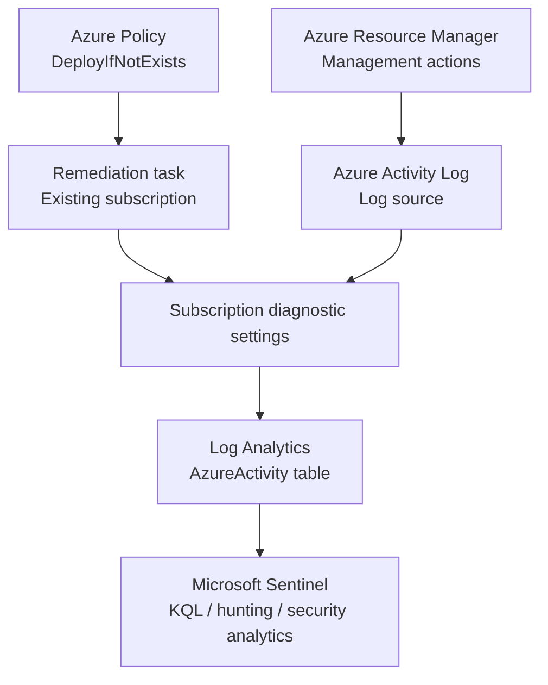

# SentinelOps MXDR

**Microsoft Sentinel platform-engineering lab**

> **Foundation verified 13 October 2026; detection-as-code implemented 18 October 2026.** The initial rule stays disabled. Azure deployment and live Kusto verification are pending restricted OIDC prerequisites and an approved PR merge. IaC and SOAR remain planned.

This technical lab covers SIEM platform deployment, source onboarding, troubleshooting, KQL investigations and ingestion-health validation. The documented environment is a lab, not a production deployment.

## Proven deliverables

| Engineering capability | Evidence |
|---|---|
| Microsoft Sentinel on Log Analytics (West Europe) | [Azure resource inventory](evidence/01-azure-resources.png) |
| Azure Activity solution and connector configured | [Connector inventory](evidence/02-azure-activity-connector.png) |
| Azure Policy `DeployIfNotExists` assigned | [Policy parameters](evidence/03-azure-policy-assignment.png) |
| Existing subscription remediated: **1/1 resources** | [Remediation result](evidence/04-remediation-complete.png) |
| Subscription-level diagnostic export to workspace | [Diagnostic setting](evidence/05-diagnostic-settings.png) |
| Activity events queryable with KQL | [Query result](evidence/06-kql-ingestion-summary.png) |
| Operations analysis and estimated ingestion latency | [Operations](evidence/07-kql-administrative-operations.png) · [Latency](evidence/08-kql-ingestion-latency.png) |

**Observed snapshot:** 9 records, 3 distinct `Caller` values; mean estimated ingestion delay 7.89 min, maximum 9 min. These are *point-in-time lab observations*, **not** production performance targets or SLAs. The connector inventory itself shows a neutral Azure Activity status, so correctness is established through the diagnostic export and actual `AzureActivity` table results, not by assuming the connector UI is green.

## Data flow



Azure Policy **governs and deploys configuration**, rather than forwarding event payloads itself. Diagnostic settings export Azure Activity to Log Analytics. Sentinel queries the ingested data. Learn more in the [architecture overview](docs/architecture/overview.md).

## Getting started

1. Follow the [manual deployment record](docs/deployment/azure-sentinel-setup.md).
2. Review the [Azure Activity onboarding runbook](docs/onboarding/azure-activity.md).
3. Read the [Azure Policy remediation incident](docs/troubleshooting/azure-policy-remediation.md).
4. Run the reusable [KQL queries](hunting/) against a workspace containing `AzureActivity`.
5. Review [validation evidence](docs/validation/first-ingestion.md) and the [roadmap](docs/roadmap.md).
6. Review [AZ-DET-001](docs/detections/AZ-DET-001.md), the [CI/CD prerequisites and runbook](docs/deployment/detection-cicd.md), [pipeline troubleshooting](docs/troubleshooting/detection-cicd.md) and [deployment evidence status](docs/validation/detection-cicd.md).

Run the dependency-free offline checks with Python 3.12+:

```powershell
python -m scripts.validate_detection
python -m unittest discover -s tests -v
```

The pipeline updates only the configured existing disabled rule through GitHub OIDC. It stops before authentication if prerequisites are missing. It never selects another subscription, provisions paid infrastructure or enables a rule. Optional live validation is manual and returns only aggregates. See [AGENTS.md](AGENTS.md) for permanent project constraints.

## Project organization

```text
docs/         Architecture, onboarding, deployment, validation, troubleshooting
hunting/      Reusable KQL queries
evidence/     Sanitized Azure screenshots
infrastructure/  Reserved for future Bicep implementation
tests/        Lightweight offline project validation
detections/azure/  Disabled REST rule definition and synchronized KQL
schemas/      Restricted approved-rule JSON Schema
scripts/      Offline validation, guarded deployment and aggregate queries
.github/workflows/  Free public-repository CI, OIDC deployment and opt-in KQL checks
```

## Costs and privacy

Azure budgets are alerts, **not hard spending limits**. Promotional credit and product trials are subject to eligibility and expiration. Verify charges, Log Analytics ingestion, retention and workspace caps in your own subscription. Do not include secrets, tenant/subscription IDs, email identities or unredacted event logs. See [evidence guidelines](docs/evidence-handling.md).

Keep the existing subscription and billing plan. The operator reports approximately 175 EUR in credit; balance and expiry remain unverified. Development and synthetic tests run locally; standard public-repository runners are free. No credit consumption is necessary for preparing this implementation. Existing Azure resources may still incur their own ongoing costs.

## Status / roadmap

- ✅ Azure foundation, Sentinel, Content Hub, Azure Policy remediation, working Azure Activity ingestion, KQL validation.
- ✅ Disabled AZ-DET-001 definition, entity/MITRE mapping, synthetic tests and guarded OIDC workflow code.
- ⬜ Restricted Azure prerequisites, approved PR merge, actual disabled-rule deployment and live Kusto evidence; alert investigations remain future work.
- ⬜ Connector health, telemetry coverage, ingestion baseline and troubleshooting.
- ⬜ Logic Apps / Python automation, idempotency, failures and cost management.
- ⬜ Bicep Infrastructure as Code and automated deployments.
- ⬜ Operational runbooks, service KPIs and handover.
