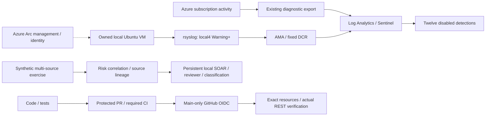
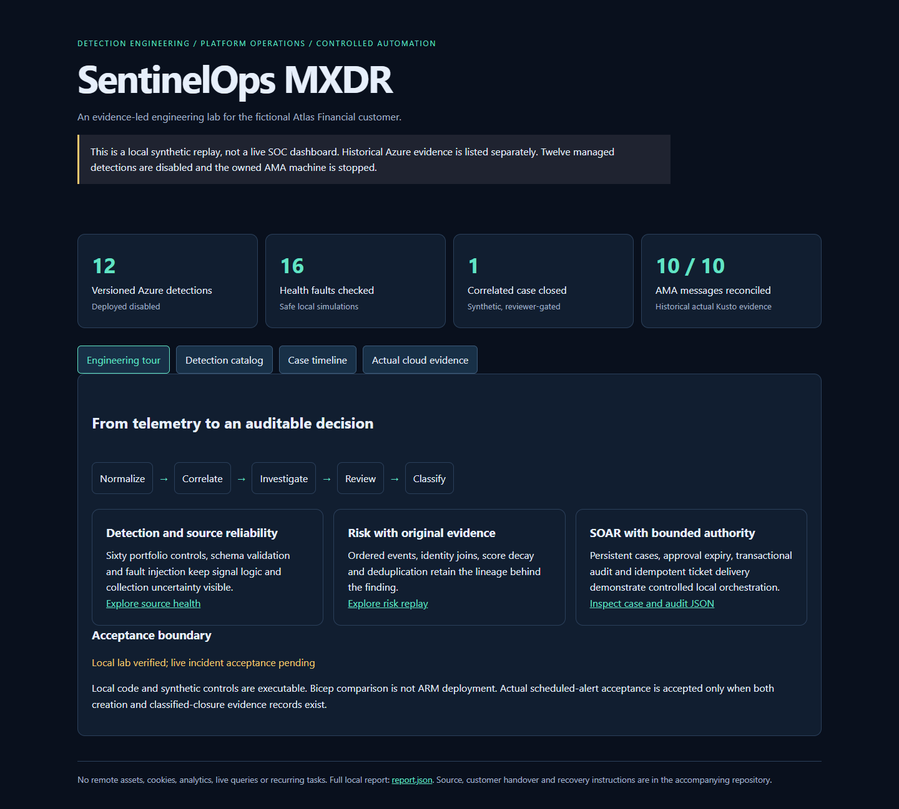

# SentinelOps MXDR

**Microsoft Sentinel engineering, detection as code and controlled SOC automation.**

A reproducible security-engineering portfolio for **Atlas Financial**, a fictional
customer. It combines actual Azure/OIDC deployment evidence with a complete
offline lab: source normalization, detection controls, telemetry health, risk
correlation, persistent case handling, reviewer decisions and customer delivery.

> **v1.0.0 — all eight engineering phases delivered within the lab scope.**
> A real scheduled test produced one alert/incident, was investigated and closed
> through OIDC; all twelve security queries also executed in Kusto. The twelve
> detections and dedicated test are disabled, the VM is stopped, and subscription
> controls are preserved. [Acceptance/evidence](docs/validation/project-completion.md)
> · [Release and portable artifact](https://github.com/miguelcastu/SentinelOps-MXDR/releases/tag/v1.0.0).

## Try it in one command

Python **3.12+**, Git and a checkout of this public repository are sufficient.
The default lab needs no Azure login, Python dependencies, hosted service or
paid account. It performs no network request or cloud operation.

```powershell
python -m lab --bundle
```

Open **`.local/lab/index.html`**. Explore the detection catalog, source-health
faults, original event timeline, correlated finding, reviewer-gated closed case
and actual cloud evidence. A portable ZIP with source, workflows, reports and
a SHA-256 manifest is created beside the output. Private pins, credentials,
VM disks and the case database are excluded. The demonstration keeps working
after the Azure account is closed.

[Architecture and evidence overview](docs/architecture/overview.md)



Cloud source proofs are point-in-time observations. The SOAR exercise is local
and synthetic; it does not create a Sentinel incident. Arc manages one owned
guest; it does not export university directory logs or join the device to Entra.



## What is implemented

| Capability | Executable implementation | Evidence and practical limit |
|---|---|---|
| Detection engineering | Twelve fixed AzureActivity rules, synchronized KQL/REST, entity mapping, investigations and sixty portfolio controls | [Actual disabled deployment](docs/validation/detection-portfolio.md); no active security coverage or measured production false-positive rate |
| Source onboarding | AzureActivity export; actual owned Linux Arc/AMA pilot; synthetic auth schema/normalizer/bounded transport | [10/10 AMA messages, 2,600 billable bytes](docs/validation/local-linux-ama.md); guest stopped, native SSH outside collection |
| Platform health | Three-source policies, freshness/quality/latency/volume checks, sixteen safe fault scenarios and maintenance handling | [Operations and SLIs](docs/operations/platform-health.md); unavailable telemetry remains Unknown |
| Risk correlation | Canonical identity joins, event lineage, ordered attack sequence, bounded scoring/decay/caps, deduplication and nine scenario controls | [Design and replay](docs/operations/risk-correlation.md); synthetic finding, not a calibrated risk probability |
| SOAR | Durable SQLite cases, structured notes, enrichment, revision/expiry-bound reviewer decisions, classified closure, idempotent local ticket and chained audit | [Implementation and six failure scenarios](docs/operations/soar.md); local roles/connectors are simulations |
| IaC and recovery | Four Bicep models, one parameter file, pinned compiler, nineteen-target comparison and destructive-change gates | [Actual compilation and 17 matching cloud contracts](evidence/completion/infrastructure.sanitized.json); two references remain unqueried, and full ARM deployment/what-if was not executed |
| Customer operations | Twenty deliverables, definition-derived coverage, RACI, runbooks, SLIs, risk register and eight fictional service tickets | [Atlas Financial handover](customer/atlas-financial/README.md); no real customer or affiliation claim |
| Portfolio delivery | One-command integrated replay, standalone evidence explorer, portable archive and presentation/interview material | [Reviewer guide](docs/portfolio/README.md) and [final acceptance](docs/validation/project-completion.md) |

The [isolated synthetic scheduler test](docs/validation/lifecycle.md) completed
the **actual** KQL match -> scheduled alert -> Sentinel incident -> investigation
-> Closed/BenignPositive classification chain. Creation and closure used GitHub
OIDC; detailed investigation used the authorized personal read-only session.
The test stayed separate from the twelve disabled security definitions. Failed
authorization and observation attempts are documented; no broader Reader or
table-data role was granted. A final OIDC reconciliation restored the existing
closed incident's activity timestamps from verified source evidence using one
exact-incident PUT. It did not reactivate the test or change its classification.
The completed test gate is disarmed.

## Verify the project

```powershell
python -m unittest discover -s tests -v
python -m scripts.validate_detection
python customer/atlas-financial/validate.py
python -m portfolio
python -m platform_health
python -m rba
python -m soar
python -m infrastructure.preview
python -m lab --bundle
```

Current local suite: **213 tests**, plus independent customer/evidence/schema
checks. Required GitHub CI runs on Python 3.12; local checks also run on 3.15.
The pinned Bicep compiler is acquired from the official release, SHA-256 checked
and actually executed in CI. Tests cover conflicting replay, lineage, approval
expiry, audit corruption, persistent retry budgets, partial/stale health,
forbidden infrastructure changes, exact resource contracts and archive privacy.
These checks are separate from actual Kusto/REST evidence.

Component demos write only ignored `.local/` artifacts. The integrated risk
finding is passed directly into SOAR with its original seven-event chain.
The separate 24-event normalization sample is labeled as a distinct fixture;
the project does not pretend it caused an unrelated real Azure incident.

## Actual cloud evidence

| Observation | Recorded result |
|---|---|
| [AzureActivity ingestion](docs/validation/first-ingestion.md) | Actual KQL arrival and policy/export troubleshooting; historical snapshot |
| [Detection OIDC deployment](https://github.com/miguelcastu/SentinelOps-MXDR/actions/runs/39235924991) | Twelve total managed Scheduled definitions disabled; existing Fusion preserved |
| [AMA main OIDC verification](https://github.com/miguelcastu/SentinelOps-MXDR/actions/runs/40774219658) | Same fixed DCR/extension/association already matching after approved one-time initialization |
| [Actual Syslog query](evidence/local-linux-ama/ingestion.sanitized.json) | Ten total/ten distinct messages, two aggregate queries, 900 payload bytes and 2,600 billable bytes |
| [Actual scheduled lifecycle](docs/validation/lifecycle.md) | One synthetic row -> one actual scheduled alert and incident -> read-only investigation -> OIDC classified closure; test disabled |
| [Twelve-query KQL runtime](evidence/completion/live-kql.sanitized.json) | One aggregate POST: AZ-DET-002 matched 3 rows, AZ-DET-003 matched 2, and the other ten matched 0; no raw events or measured false-positive rate |
| [Compiler-to-live OIDC](evidence/completion/infrastructure.sanitized.json) | 17 Matching and 2 Unknown through six GETs; no resource writes or VM start |
| [Final 76-check preservation audit](evidence/completion/final-preservation.sanitized.json) | 14 unique rules: 12 managed disabled, one disabled test and original Fusion enabled; 22 exact assignments across 10 roles; original rule properties preserved, incident closed and VM stopped |
| [Subscription/credit](evidence/completion/eligibility.sanitized.json) | Same Enabled subscription, spending limit On, published EUR 175.99436818021823; expiry 12 November 2026 18:00:16 UTC |

Raw logs, identity fields and subscription/tenant identifiers are not release
artifacts. Cloud records remain dated evidence, not a promise the subscription
will still exist when someone clones the repository. See [evidence handling](docs/evidence-handling.md).

## Security and cost design

The control path is **feature branch -> protected PR -> required CI -> merged
main -> approved environment -> short-lived OIDC -> exact-resource REST ->
read-back**. PR validation has no Azure credentials/OIDC permission. The
existing CI identity and immutable repository/environment trust are reused;
actions and the compiler are pinned. No client secret or public SSH endpoint.
See [security boundaries](docs/security.md) and [recovery](docs/deployment/recovery.md).

After acceptance, the lifecycle approval gate, recovery/reconciliation references
and exact-incident identifier secret were removed from GitHub. Existing OIDC
configuration and all 22 Azure assignments were preserved; disarming the workflow
did not delete Azure roles or resources.

The subscription and plan are preserved. Workspace pricing `pergb2018`,
30-day retention, 0.1 GB/day cap, budgets and diagnostics are unchanged.
The operator permits a maximum EUR 175 for necessary completion work; the
offline implementation uses **zero additional Azure ingestion or paid services**.
Available credit is not a spending target. Closed credit can lag charges;
2,600 historical billable bytes are not a measured invoice or zero-cost proof.
No Azure VM, paid add-on, Defender plan, university source or recurring sender.

## Review and demonstrate

- [Five-minute demo](docs/portfolio/demo-five-minutes.md) and [fifteen-minute presentation](docs/portfolio/presentation-fifteen-minutes.md).
- [Engineering decisions](docs/portfolio/engineering-decisions.md) and [troubleshooting cases](docs/portfolio/engineering-case-studies.md).
- [Interview and CV wording](docs/portfolio/interview-and-cv.md).
- [Customer package](customer/atlas-financial/README.md), [acceptance/limitations](docs/validation/project-completion.md), [operator-led account closure](customer/atlas-financial/handover.md).

## Repository map

```text
lab/                  Integrated replay, evidence explorer and portable release
detections/azure/     Twelve disabled REST/KQL definitions
portfolio/            Exact contracts and sixty synthetic controls
ingestion/            Synthetic event schema, normalization and bounded transport
ama/                  Actual pilot source, fixed AMA contract and aggregate KQL
platform_health/      Source policies, safe faults, metadata collector and reports
rba/                  Canonical risk/sequence engine and original-event lineage
soar/                 Persistent local case workflow, approvals and audit
infrastructure/       Bicep models, compiler lock and nonmutating preview
lifecycle/            Isolated approval-gated real-scheduler test contract
customer/atlas-financial/  Operational delivery, coverage and fictional tickets
docs/                 Architecture, runbooks, validation and portfolio material
evidence/             Sanitized actual records and labeled synthetic evidence
.github/workflows/    Required offline CI and manual scoped OIDC operations
tests/                Unit, behavior, security and integration checks
```

This is an engineering lab with explicit acceptance boundaries, not a deployed
production MXDR service. Preserve those boundaries when presenting the project.
