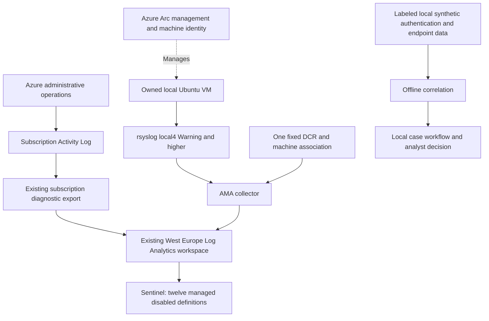

# Monitoring design and shared responsibilities

**Fictional service design; actual lab boundaries are explicit.**

## Architecture and data ownership

The subscription is the management/billing scope; the tenant authenticates
access; the workspace stores/query logs. None is a synonym for the data source.
AzureActivity concerns subscription management operations. The Linux pilot
concerns one owned guest's selected Syslog facility. The workspace is their
destination, not authorization to collect every tenant identity event.

GitHub is the configuration control path: reviewed code -> required offline
CI -> protected main -> approved environment -> short-lived Azure OIDC ->
exact resource operation -> actual REST read-back. It does not send the local
guest's logs and does not store an Azure account password.

## Source service catalog

| Source | Owner / collection boundary | Destination / state | Acceptance and gap |
|---|---|---|---|
| AzureActivity | Lab subscription owner; existing diagnostic export | `AzureActivity`; historical real query evidence | Export + actual rows, not connector badge alone. Current freshness is not implied by old evidence. |
| Local Linux Syslog | Operator-owned `lab-sentinelops-linux-01`; only local4 Warning+ | `Syslog`; one real ten-message pilot; guest stopped | Ten unique messages reconciled; no native SSH/authpriv, process or network coverage. |
| Synthetic authentication | Local generator; fictional accounts and documentation IP ranges | Local normalized JSON; proposed `SentinelOpsAuth_CL` remains optional/unprovisioned | Schema, timestamps, parser and bounded transport controls verified offline. |
| Synthetic endpoint signals | Explicit fictional RBA events | Local RBA dataset only | Tests correlation logic; no EDR sensor, endpoint protection or real process telemetry. |
| RBA finding / local case | Deterministic synthetic correlation and local case store | Local investigation artifacts | Demonstrates orchestration; not a Sentinel/Defender incident. |

Data-source and deployment inventories are linked from
[project status](../../docs/PROJECT_STATUS.md). Before another source is accepted,
record owner, lawful scope, expected event types, required licensing, fields,
timestamp semantics, routing, retention/cost, heartbeat behavior and a finite
reconciliation plan. Use the existing [source template](../../docs/onboarding/source-template.md).

## Responsibility matrix

R = performs work; A = accepts the result; C = consulted; I = informed.
These are exercise roles, not actual employees or a contracted service.

| Activity | Customer service owner | Customer cloud owner | MXDR platform engineer | Detection engineer | SOC analyst |
|---|---|---|---|---|---|
| Approve monitoring scope / budget | A | R | C | C | I |
| Establish source permissions / export | I | A | R | C | I |
| Manage tenant privacy/licensing | A | R | C | I | I |
| Engineer/test a detection | I | C | C | A/R | C |
| Approve activation / tuning scope | A | C | R | R | C |
| Triage / investigate a finding | I | C | C | C | A/R |
| Authorize containment | A | R | C | C | C |
| Execute permitted containment | I | A/R | C | I | C |
| Investigate pipeline/health failure | I | C | A/R | C | C |
| Review spend / expiration | A | R | C | I | I |
| Review evidence and accept handover | A | R | R | C | C |

In the personal lab the operator can fill several roles, but approvals remain
separate recorded decisions. A simulated approval demonstrates an application
workflow; it never grants actual Azure permissions or authorizes real action.

## Access and data contract

- The existing CI identity is reused; resource-scoped writers are separate from
  workspace metadata/inventory readers. Personal MFA is for authorized setup
  and verification, not ordinary rule deployment.
- Default work is offline. Source identifiers, private fingerprints and short-lived
  credentials remain under ignored local state; only sanitized aggregates and
  public configuration are committed.
- Source time, ingestion observation time and investigation time are separate.
  Preserve UTC offsets and original event IDs; do not replace event time with
  case creation time or interpret shared IP as identity equivalence.
- No rule deletion, automatic account blocking, third-party SaaS, university
  directory ingestion or Azure account closure is implemented by this package.

See the [security boundary](../../docs/security.md) and
[architecture overview](../../docs/architecture/overview.md) for implementation
details. The [handover](handover.md) records restart and account-closure risks.
