# Architecture — Azure foundation and ingestion

## Environment

| Component | Lab value |
|---|---|
| Resource group | `rg-sentinelops-mxdr` |
| Resource group metadata region | Spain Central |
| Workspace | `law-sentinelops-mxdr-euw` |
| Workspace and Sentinel location | West Europe |
| Source | Azure Activity (subscription management plane) |
| Output table | `AzureActivity` |
| Export mechanism | Subscription diagnostic settings |

The resource-group metadata location is distinct from the physical region of the Log Analytics workspace. The lab was migrated to a compatible Sentinel workspace region rather than attempting to change the existing workspace's location.

## Responsibilities

- **Azure Resource Manager:** management operations that produce activity events.
- **Azure Activity Log:** native subscription-level administrative event log. Not a Defender endpoint sensor and not Entra ID sign-in logs.
- **Azure Policy:** policy assigned at subscription scope with `DeployIfNotExists` and `logsEnabled=True`, targeting a specific Log Analytics workspace.
- **Remediation:** applies missing diagnostic settings to a pre-existing non-compliant subscription.
- **Diagnostic settings:** native Azure Monitor export configuration; observed name `subscriptionToLa`.
- **Log Analytics:** destination and query engine for `AzureActivity` records.
- **Microsoft Sentinel:** security analytics, detection and hunting over data in the workspace.

## Engineering trade-offs

| Decision | Why | Limitation |
|---|---|---|
| Native Azure Activity as first log source | Quick, real operational telemetry without VM agents | Does not cover sign-ins, endpoints or network flows |
| Policy-driven diagnostic settings | Standardized, auditable configuration | Existing subscriptions may require remediation; identity permissions matter |
| Single West Europe workspace | Simple compatible lab deployment | Does not demonstrate resilience or multi-tenancy |
| KQL query validation | Proves destination receives events | Does not prove every source category is ingested |
| Budget alerts and low-volume workload | Keeps lab spending observable | No guaranteed upper bound on Azure charges |

## Detection-as-code control path

```mermaid
flowchart LR
    DEV[Feature branch: KQL / disabled REST JSON] --> TEST[Offline validation and synthetic fixtures]
    TEST --> PR[Reviewed PR]
    PR --> MAIN[Operator merges main]
    MAIN --> ENV[Main-only sentinel-lab environment]
    ENV --> OIDC[Dedicated Azure OIDC identity]
    OIDC --> RULE[Existing AZ-DET-001 only: disabled]
    RULE --> VERIFY[Azure GET verifies persisted state]
```

No part of the control path provisions a workspace, connector, playbook or paid compute. The deployment principal's write permission is scoped to the exact existing analytics rule; workspace metadata and optional AzureActivity query permissions are separate assignments. The personal MFA session is confined to the explicitly authorized initial setup and verification; routine deployments use OIDC. Environment review flags default to false until prerequisites are reviewed. Actual Azure OIDC authentication, both disabled-rule deployments and final API comparisons have succeeded. See the [verified platform record](../validation/platform-setup.md) and [security boundary](../security.md).

Offline PR CI has no OIDC permission or Azure secrets. The opt-in live validation workflow performs aggregate and synthetic queries only. Read the [deployment runbook](../deployment/detection-cicd.md) for limitations of RBAC, the upsert API, current MITRE mapping and query costs. Future phases cover data health, SOAR and reproducible Bicep deployments.

## Second source: local implementation, proposed cloud path

The [synthetic authentication package](../../ingestion/) generates labeled fictional events, validates the source contract and projects ASIM-shaped fields before batching. The executable demo ends in ignored local JSON files; it does not authenticate or upload. The real transport is tested with mocks. Two source formats are demonstrable, but AzureActivity remains the only source with actual cloud ingestion evidence.

After resource/cost/RBAC approval, the proposed path uses one Direct DCR and one custom Analytics table in the existing West Europe workspace. No DCE or compute is required by this design. REST bodies are checked for exact stream/table schema agreement and one fixed destination. Provisioning, sending and query permissions must be reviewed separately from rule-deployment roles. See [onboarding](../onboarding/synthetic-authentication.md) and [acceptance status](../PROJECT_STATUS.md).

## Personally owned local guest: proposed AMA data path

On 28 October the operator authorized preparing a local VM on a personal PC.
The [dedicated Ubuntu guest](../onboarding/local-linux-ama.md) has a separate
source inventory and local SSH evidence. Its proposed cloud path is Linux
rsyslog -> AMA -> the existing workspace's `Syslog` table. Azure Arc would
provide machine management and identity, the DCR would select only local4
Warning and above, and one association would bind that DCR to this guest.
No Azure VM, tenant-wide identity log export or university device join is
involved. Registering an Arc resource still uses the subscription's existing
tenant and Azure access inheritance.

The local guest, Arc package, Arc registration, AMA extension provisioning,
DCR association and queried messages are distinct acceptance stages. Cloud
registration and ingestion remain pending; existing source-health output
does not claim this planned source is live. PR #13 local preparation introduced
no Azure workflow or permissions. The subsequently approved pilot adds a manual
main-only OIDC configuration workflow, exact-target AMA roles and a local
single-batch sender; actual deployment and ingestion still need verification. The [validation
record](../validation/local-linux-ama.md) identifies the actual completed
stages and [the runbook](../onboarding/local-linux-ama.md) specifies the cloud
approved exceptions and protected PR/OIDC path.
