# Architecture — Azure foundation and ingestion

## Environment

| Component | Lab value |
|---|---|
| Resource group | `rg-sentinelops-mxdr` |
| Resource group metadata region | Spain Central |
| Workspace | `law-sentinelops-mxdr-euw` |
| Workspace and Sentinel location | West Europe |
| Source | Azure Activity (subscription management plane) |
| Output table | `AzureActivity` |
| Export mechanism | Subscription diagnostic settings |

The resource-group metadata location is distinct from the physical region of the Log Analytics workspace. The lab was migrated to a compatible Sentinel workspace region rather than attempting to change the existing workspace's location.

## Responsibilities

- **Azure Resource Manager:** management operations that produce activity events.
- **Azure Activity Log:** native subscription-level administrative event log. Not a Defender endpoint sensor and not Entra ID sign-in logs.
- **Azure Policy:** policy assigned at subscription scope with `DeployIfNotExists` and `logsEnabled=True`, targeting a specific Log Analytics workspace.
- **Remediation:** applies missing diagnostic settings to a pre-existing non-compliant subscription.
- **Diagnostic settings:** native Azure Monitor export configuration; observed name `subscriptionToLa`.
- **Log Analytics:** destination and query engine for `AzureActivity` records.
- **Microsoft Sentinel:** security analytics, detection and hunting over data in the workspace.

## Engineering trade-offs

| Decision | Why | Limitation |
|---|---|---|
| Native Azure Activity as first log source | Quick, real operational telemetry without VM agents | Does not cover sign-ins, endpoints or network flows |
| Policy-driven diagnostic settings | Standardized, auditable configuration | Existing subscriptions may require remediation; identity permissions matter |
| Single West Europe workspace | Simple compatible lab deployment | Does not demonstrate resilience or multi-tenancy |
| KQL query validation | Proves destination receives events | Does not prove every source category is ingested |
| Budget alerts and low-volume workload | Keeps lab spending observable | No guaranteed upper bound on Azure charges |

## Detection-as-code control path

```mermaid
flowchart LR
    DEV[Feature branch: KQL / disabled REST JSON] --> TEST[Offline validation and synthetic fixtures]
    TEST --> PR[Reviewed PR]
    PR --> MAIN[Operator merges main]
    MAIN --> ENV[Main-only sentinel-lab environment]
    ENV --> OIDC[Dedicated Azure OIDC identity]
    OIDC --> RULE[Existing AZ-DET-001 only: disabled]
    RULE --> VERIFY[Azure GET verifies persisted state]
```

No part of the control path provisions a workspace, connector, playbook or paid compute. The deployment principal's write permission is scoped to the exact existing analytics rule; workspace metadata and optional AzureActivity query permissions are separate assignments. The personal Azure session is excluded from autonomous cloud work. Environment review flags default to false until prerequisites are reviewed. The code is implemented; actual Azure authentication/deployment is not yet evidenced.

Offline PR CI has no OIDC permission or Azure secrets. The opt-in live validation workflow performs aggregate and synthetic queries only. Read the [deployment runbook](../deployment/detection-cicd.md) for limitations of RBAC, the upsert API, current MITRE mapping and query costs. Future phases cover data health, SOAR and reproducible Bicep deployments.
