# Architecture — Azure foundation and ingestion

## Environment

| Component | Lab value |
|---|---|
| Resource group | `rg-sentinelops-mxdr` |
| Resource group metadata region | Spain Central |
| Workspace | `law-sentinelops-mxdr-euw` |
| Workspace and Sentinel location | West Europe |
| Source | Azure Activity (subscription management plane) |
| Output table | `AzureActivity` |
| Export mechanism | Subscription diagnostic settings |

The resource-group metadata location is distinct from the physical region of the Log Analytics workspace. The lab was migrated to a compatible Sentinel workspace region rather than attempting to change the existing workspace's location.

## Responsibilities

- **Azure Resource Manager:** management operations that produce activity events.
- **Azure Activity Log:** native subscription-level administrative event log. Not a Defender endpoint sensor and not Entra ID sign-in logs.
- **Azure Policy:** policy assigned at subscription scope with `DeployIfNotExists` and `logsEnabled=True`, targeting a specific Log Analytics workspace.
- **Remediation:** applies missing diagnostic settings to a pre-existing non-compliant subscription.
- **Diagnostic settings:** native Azure Monitor export configuration; observed name `subscriptionToLa`.
- **Log Analytics:** destination and query engine for `AzureActivity` records.
- **Microsoft Sentinel:** security analytics, detection and hunting over data in the workspace.

## Engineering trade-offs

| Decision | Why | Limitation |
|---|---|---|
| Native Azure Activity as first log source | Quick, real operational telemetry without VM agents | Does not cover sign-ins, endpoints or network flows |
| Policy-driven diagnostic settings | Standardized, auditable configuration | Existing subscriptions may require remediation; identity permissions matter |
| Single West Europe workspace | Simple compatible lab deployment | Does not demonstrate resilience or multi-tenancy |
| KQL query validation | Proves destination receives events | Does not prove every source category is ingested |
| Budget alerts and low-volume workload | Keeps lab spending observable | No guaranteed upper bound on Azure charges |

## Detection-as-code control path

```mermaid
flowchart LR
    DEV[Feature branch: KQL / disabled REST JSON] --> TEST[Offline validation and synthetic fixtures]
    TEST --> PR[Reviewed PR]
    PR --> MAIN[Operator merges main]
    MAIN --> ENV[Main-only sentinel-lab environment]
    ENV --> OIDC[Dedicated Azure OIDC identity]
    OIDC --> RULE[Reviewed fixed analytics rules: disabled]
    RULE --> VERIFY[Azure GET verifies persisted state]
```

No part of the control path provisions a workspace, connector, playbook or paid compute. Analytics writes are scoped separately to the twelve reviewed rule resources; workspace metadata and optional AzureActivity query permissions are separate assignments. The personal MFA session is confined to the explicitly authorized initial setup and verification; routine deployments use OIDC. Environment review flags default to false until prerequisites are reviewed. Actual Azure OIDC authentication, disabled-rule deployments and final API comparisons have succeeded. See the [verified platform record](../validation/platform-setup.md) and [security boundary](../security.md).

Offline PR CI has no OIDC permission or Azure secrets. The opt-in live validation workflow performs aggregate and synthetic queries only. Read the [deployment runbook](../deployment/detection-cicd.md) for limitations of RBAC, the upsert API, current MITRE mapping and query costs. Future phases cover data health, SOAR and reproducible Bicep deployments.

## Second source: local implementation, proposed cloud path

The [synthetic authentication package](../../ingestion/) generates labeled fictional events, validates the source contract and projects ASIM-shaped fields before batching. The executable demo ends in ignored local JSON files; it does not authenticate or upload. The real transport is tested with mocks. This synthetic-authentication format remains offline. AzureActivity and the separately approved local Linux Syslog pilot have actual cloud ingestion evidence; their acceptance stages must be kept distinct.

After resource/cost/RBAC approval, the proposed path uses one Direct DCR and one custom Analytics table in the existing West Europe workspace. No DCE or compute is required by this design. REST bodies are checked for exact stream/table schema agreement and one fixed destination. Provisioning, sending and query permissions must be reviewed separately from rule-deployment roles. See [onboarding](../onboarding/synthetic-authentication.md) and [acceptance status](../PROJECT_STATUS.md).

## Personally owned local guest: verified AMA pilot

The [dedicated Ubuntu guest](../onboarding/local-linux-ama.md) runs in local
VirtualBox on a personally owned PC. Its data path is **rsyslog -> AMA -> the
existing workspace's Syslog table**. Arc supplies machine management and a
system-assigned identity; the DCR selects only local4 Warning and above, and
one association binds it to the guest. This does not collect all subscription
logs, tenant sign-ins or other students' activity. The management resources
still use the subscription's existing tenant; there is no university device
join, tenant migration or Azure VM.

Actual REST verified registration, AMA, DCR and association. Azure rejected
RBAC at the absent DCR, so a separately approved one-time personal bootstrap
initialized only the three targets; exact-resource RBAC and protected main
OIDC verification followed. The routine control path uses the existing CI
identity with three exact child-resource writers and one machine metadata
reader. The sender runs locally, uses a persistent single-attempt ledger and
does not expose SSH to public runners. No GitHub sender or schedule exists.

On 28 October actual Kusto reconciled one ten-message/900-message-byte batch:
ten total and distinct, 2,600 billable bytes, two aggregate queries. The guest
was then powered off. [Actual validation](../validation/local-linux-ama.md)
separates personal initialization, OIDC verification, queried data and shutdown.
The [separate source inventory](../../ama/source.json) records bounded verified
ingestion; AMA health policies/automatic collection are not implemented in the
existing health tool. No native SSH or active Linux detection coverage follows
from the local4 test. Starting the guest would resume its installed collection
services and requires attention to the approved scope and budget.
