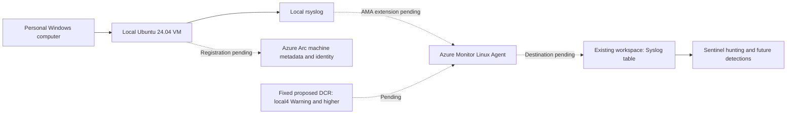

# Personally owned Linux machine: local VM, Arc and AMA

The operator requested a machine that sends its own logs through Azure Monitor
Agent (AMA), rejected university directory ingestion, and authorized preparing
a VM on a personally owned Windows computer on 28 October 2026. This increment
prepares that local machine and a fixed cloud design. It does not claim that
the machine is already registered in Azure or that Sentinel receives its logs.
See the [actual validation record](../validation/local-linux-ama.md).

## Architecture and scope



VirtualBox runs the compute on the personal PC; this is not an Azure VM.
Arc would represent this one guest as an Azure resource and give it a managed
identity. AMA would collect the facilities and severities selected by its DCR.
The DCR association connects that exact machine to that exact collection rule.
Arc is management plumbing; it is not the log collector. Sentinel uses the
workspace's ingested tables rather than receiving a separate copy.

The proposed source is **this guest's Linux Syslog**, not all subscription,
tenant or workspace logs. The subscription contains the management resources;
the existing tenant authenticates access. This design does not join the PC or
guest to the university directory, export Entra sign-ins, create an application
registration or read other students' activity. Azure resources still belong
to the subscription's existing tenant and inherited Azure administration rules
still apply. No tenant migration or subscription switch is proposed.

Ubuntu 24.04 is supported by both [Arc](https://learn.microsoft.com/azure/azure-arc/servers/prerequisites)
and [AMA](https://learn.microsoft.com/azure/azure-monitor/agents/azure-monitor-agent-supported-operating-systems).
The PC's Windows Home edition and university account are not used for Entra
device enrollment. The local guest can remain powered off between lab sessions.

## Local preparation and normal operation

The owned VM is `lab-sentinelops-linux-01`: 1 vCPU, 1,536 MiB RAM, a dynamic
disk imported from the official Ubuntu cloud OVA, NAT networking, and a single
SSH port forward **127.0.0.1:22221 -> guest:22**. No LAN-wide listener, bridged
NIC, shared folders, clipboard, drag/drop or remote display is configured.
NAT permits guest outbound access; it is not a complete host-isolation boundary.

The official OVA's published SHA-256 is checked before import. NoCloud media
creates the dedicated `labops` account, an SSH public key, locked password,
disabled root/password SSH, UTC timezone and rsyslog prerequisites. Its sudo
access is limited to this dedicated lab guest. The private key, guest disk,
seed, known_hosts, installer and diagnostics stay in ignored `.local/ama-vm/`.
The private key's inherited ACL is removed and access is granted to its owner.
Keep backups of the key private; the repository does not contain it.

From the repository root, preview without downloads, VM changes or Azure calls:

```powershell
python -m scripts.prepare_local_ama_vm
python -m scripts.install_local_arc_agent
python -m ama
```

For a fresh, approved local installation with VirtualBox already installed:

```powershell
uv run --with pycdlib --no-project python -m scripts.prepare_local_ama_vm --apply --start
python -m scripts.verify_local_ama_vm
python -m scripts.install_local_arc_agent --apply
python -m scripts.test_local_syslog --apply
```

The preparation script rejects an existing VM name. `--resume` is only for
finishing configuration of the **stopped** guest whose configuration file
resolves inside this repository's dedicated directory. It does not recreate,
delete or reset the guest. Do not rerun preparation just to start an existing
machine. The mutable Ubuntu `current` manifest must still match the downloaded
OVA; a later release mismatch requires an explicit image refresh, not importing
an unchecked image. `pycdlib` is an ephemeral local dependency, not a CI dependency.

Normal start, verification and SSH commands:

```powershell
& 'C:\Program Files\Oracle\VirtualBox\VBoxManage.exe' startvm lab-sentinelops-linux-01 --type headless
python -m scripts.verify_local_ama_vm
ssh -i .local/ama-vm/id_ed25519 -p 22221 -o BatchMode=yes -o StrictHostKeyChecking=yes -o UserKnownHostsFile=.local/ama-vm/known_hosts labops@127.0.0.1
```

Verification trusts a previously unseen key only in the dedicated known_hosts
file, then rejects changes. It returns sanitized OS/service/configuration
facts, not raw cloud-init logs or real identities. Shut down gracefully after
use:

```powershell
ssh -i .local/ama-vm/id_ed25519 -p 22221 -o BatchMode=yes -o StrictHostKeyChecking=yes -o UserKnownHostsFile=.local/ama-vm/known_hosts labops@127.0.0.1 'sudo shutdown -h now'
```

There is no auto-start or recurring task. Do not disable Windows security,
change other VMs or upgrade the host hypervisor to fix this lab. The initial
two-vCPU boot panicked; a minimal paravirtualization attempt also stalled.
The working configuration uses one vCPU, KVM paravirtualization and enabled
APIC/x2APIC while keeping the Windows hypervisor enabled. This is an observed
compatibility outcome, not a proven kernel-bug diagnosis.

The local Arc installer uses Microsoft's [published installation method](https://learn.microsoft.com/azure/azure-arc/servers/onboard-portal).
Its script bytes are pinned to the reviewed SHA-256 in the wrapper; a changed
download stops before execution. The wrapper runs the package installer only,
never `azcmagent connect`. Microsoft may receive installer diagnostics on a
failure. There are no Azure credentials in the guest during this preparation.
The Arc package is separate from AMA; installing it alone is not onboarding.

The preview-first local Syslog test sends exactly ten labeled messages and
reconciles their occurrences in the guest's local log, returning counts only.
It refuses an AMA installation or an Arc state other than Disconnected. Its
successful result proves local rsyslog only; do not use it as a live sender.
The first attempt stopped before sending because systemctl uses exit 1 for an
absent unit; the wrapper now handles that expected absence and rejects other
errors. The successful batch contained 900 message bytes.

## Concrete cloud rollout proposal: not executed

The [fixed contract](../../ama/plan.py) renders only the following targets in
the existing `rg-sentinelops-mxdr`, West Europe. Subscription identifiers are
read from the ignored existing pin; they are never committed.

| Target | Purpose | State in this increment |
|---|---|---|
| Arc machine `lab-sentinelops-linux-01` | Represent this one local guest; managed identity | Not registered |
| DCR `dcr-sentinelops-ama-linux` | One Syslog source, one existing workspace destination | Offline body only |
| Machine extension `AzureMonitorLinuxAgent` | Install and manage AMA | Offline body only |
| Association `sentinelops-ama-linux` | Bind this machine to this DCR | Offline body only |
| Existing workspace `law-sentinelops-mxdr-euw` | Destination `Syslog` table | No settings changed |

Render private resource bodies without contacting Azure:

```powershell
python -m ama --render-private
```

The fixed pilot selects only facility **local4**, minimum **Warning**:
Warning, Error, Critical, Alert and Emergency. No wildcard, Info/Debug,
auth/authpriv, performance counters, extra workspace, custom table, DCE,
VM Insights, Defender, Update Manager or Change Tracking is included. The
standard `Syslog` destination is used; no custom-table provisioning is planned.
The body validator rejects changing the complete DCR contract, including extra
streams or destinations. Rendering is not a deployer or an authorization check.

Local4 is deliberately reserved for labeled lab messages. It demonstrates
Linux Syslog transport with a tiny workload. It does **not** collect native
SSH authentication failures (often Info), Windows Security events, Sysmon,
process executions or network traffic. This is not a security-detection rule;
MITRE mapping and false-positive accuracy are **not applicable** to its ten
synthetic transport checks. The existing twelve disabled AzureActivity rules
do not gain endpoint coverage by adding this source.

Before creating or connecting cloud resources, the operator must approve this
specific exception to the current [deployment/ingestion boundary](../../AGENTS.md):

1. Register only missing Arc prerequisite providers: `Microsoft.HybridCompute`,
   `Microsoft.GuestConfiguration`, `Microsoft.HybridConnectivity`. Read-only
   inspection on 28 October found all three unregistered; Insights was registered.
   Do not register SQL features or enable add-on plans.
2. Review subscription policy/automatic onboarding effects, existing plans,
   inherited access and the fresh credit balance. Stop if an enforced policy
   introduces a paid feature; do not alter policy or billing to work around it.
3. Review and merge a fixed-target, manual-main OIDC deployment implementation
   through the protected PR path, with the existing CI identity, exact narrow
   permissions and actual REST read-back. Current rule-deployment permissions
   do not authorize Arc/DCR/extension deployment. No live sender workflow or
   new role has been added by this preparation.
4. Approve the one-time local `azcmagent connect` administrative setup exception
   as well. The private guest is not reachable from a public GitHub runner.
   Use the existing pinned subscription and legitimate MFA authentication;
   do not expose SSH to the Internet, create a self-hosted runner, use Cloud
   Shell, weaken Conditional Access or create a long-lived service-principal
   secret. Never put a token in command history, arguments or public job logs.
5. Deploy/read back only the fixed DCR, AMA extension and association. Confirm
   the Arc/AMA services, their provisioning results and the exact collection
   contract. Stop on conflicting ownership, an extra DCR/destination, a paid
   auto-deployment or ambiguous state.
6. Generate **one batch of ten** labeled messages using [the bounded generator](../../ama/pilot.py),
   then send them with Linux `logger`, facility `local4.warning`, tag
   `sentinelops-lab`. Payloads include a unique run ID and `seq=01/10` through
   `seq=10/10`, at most 4,096 message bytes. There is no executable sender in
   this increment. Do not send again just because ingestion is delayed.
7. Execute the [one-hour aggregate query](../../ama/validation.kql) manually
   with the exact private machine ID and run ID. Expected: ten total and ten
   distinct messages, last-seen time and billable bytes. Extra rows indicate
   duplication; missing rows indicate incomplete acceptance. No raw log,
   account or IP output; no recurring query. Query/ingestion costs are not
   established by local tests.
8. Shut down the local guest; verify it is powered off. Record sanitized
   Azure REST, agent and query evidence separately. Only then promote this
   source into the active health inventory and design Syslog detections.

## Budget and stop conditions

Local compute does not consume Azure VM credit. Arc's [basic control plane](https://azure.microsoft.com/pricing/details/azure-arc/core-control-plane/)
and optional paid services must be distinguished. Azure Monitor/Sentinel
ingestion can be billable: neither AMA nor the small source size is a promise
of zero charges. The current spending limit, daily cap, retention, pricing,
budget, subscription and plan must remain unchanged.

The read-only credit API still reported **EUR 175.99436818021823** on 28 October,
expiring **12 November 2026, 18:00:16 UTC**. Closed balances can lag actual
usage; this is not a fresh spending guarantee. This increment creates no Azure
resources and sends no logs to Azure. A finite 4 KiB message payload is not a
4 KiB billing limit: metadata, retries, duplicates and other collected messages
can add volume. The DCR's severity selection also admits other local4 producers.
Do not leave the guest running unattended after an approved live pilot, and
review costs before any repeat or expansion to native authentication logs.

If authentication, policy, budget or permissions block onboarding, keep the
guest stopped and report the exact stage. A successful package install,
agent heartbeat, green connector UI or local `logger` command alone is not
proof that the messages reached `Syslog`.

## Troubleshooting and evidence

| Symptom | Check without broadening collection |
|---|---|
| SSH timeout | Guest console, VM state, loopback NAT rule, cloud-init progress |
| Boot panic/stall | The recorded one-vCPU/APIC configuration; preserve Windows protections |
| cloud-init running/error | Local guest service and private logs; do not claim preparation complete |
| Arc disconnected | Expected before approved registration; package installation is insufficient |
| AMA provision failure | Exact extension REST status and private guest logs; no add-on plans |
| No pilot rows | Machine/run filters, rsyslog facility/severity, association and ingestion delay |
| Duplicate rows | Extra DCR associations/destinations or replay; do not resend blindly |
| Quiet stopped machine | Expected maintenance; no continuous availability claim |

The proposed source inventory is [ama/source.json](../../ama/source.json).
It remains separate from [active/synthetic inventory](../../ingestion/sources.json)
until verified cloud ingestion and corresponding health-policy work exist.
The existing health tool therefore does not silently report AMA as healthy.
