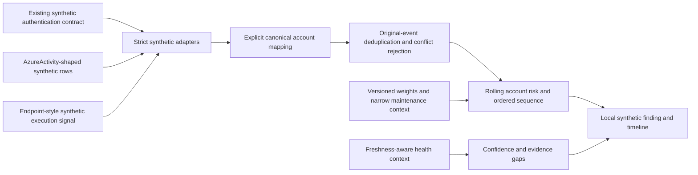

# Phase 4: offline entity risk and advanced correlation

This package implements **AF-RBA-001**, a local synthetic correlation rule for the fictional Atlas Financial customer. It produces reproducible findings, entity scores, contribution ledgers and investigation context. It does not deploy a Sentinel rule, collect live telemetry, execute an attack, create an incident or perform containment.

## Run and replay

```powershell
python -m rba
python -m unittest discover -s tests -v
```

Open `.local/rba/dashboard.html`. Select an account and move the replay slider to inspect precomputed scores at each event time. The timeline uses ordered samples rather than a proportional time axis; explicit UTC timestamps are displayed. The contribution ledger is the **final analysis-as-of ledger**, labeled separately from the replay sample. Entity peak is the historical peak within the evaluated lookback, not a prediction at the replay time. JSON, investigation Markdown and the synthetic input dataset are saved alongside the dashboard. There are no external assets, web server or network requests.

```powershell
python -m rba --dataset .local/rba/dataset.synthetic.json --output .local/rba-replayed
python -m rba --dataset .local/rba/dataset.synthetic.json --as-of 2026-10-18T14:00:00Z --output .local/rba-decayed
python -m rba --health-report evidence/phase-3/health-report.sanitized.json --output .local/rba-with-health-context
```

The default dataset is historical and explicitly synthetic. An imported dataset must retain the same strict synthetic contract; this CLI has no live-data mode. An earlier `--as-of` than any supplied event is rejected rather than silently using future information. Later evaluation demonstrates decay while preserving a finding already observed within the analysis lookback.

## Architecture and identity boundaries



The scored entity is the initiating **Account**. Host, source IP and resource labels are investigation context; they do not merge account histories or produce standalone alerts. Multiple accounts sharing a NAT address remain separate. No aggregate "total platform risk" is computed by summing account scores.

The [explicit alias registry](../../rba/entity-map.json) maps fictional Azure callers to fictional authentication users. This is a declared laboratory identity relationship, not proof that usernames, IPs or real cloud principals belong to the same person. An unknown Azure caller stops normalization. Azure RBAC signals identify the initiating actor and fictional target scope; they do not reveal the assigned role, beneficiary, privilege or actual authorization. Those require investigation.

The endpoint source is a **synthetic event format only**, not a deployed third connector or an endpoint agent. No script or PowerShell payload is executed. The Azure-shaped adapter allowlists role-assignment writes, diagnostic writes/deletes and policy-assignment writes; failed relevant operations become low-weight administrative-failure signals. Started/accepted or unrelated operations produce no signal. [Authentication normalization](../../rba/adapters.py) reuses the existing Phase 2 contract.

## Contract and bounds

[Signal schema](../../schemas/rba-signal.schema.json) documents the normalized fields. Runtime validation also enforces source/kind pairing, required scope/host context and documentation-only IP addresses. Only `synthetic-user-NN`, `lab-auth-NN`, fictional resource labels and synthetic original/envelope IDs are accepted. Unknown fields such as raw command text or an event-supplied approval flag are rejected.

| Bound | Limit |
|---|---|
| Input dataset | 512 KiB and 500 events maximum |
| Retained actors | 32 maximum |
| Analysis lookback | Four hours, inclusive |
| Scoring window | 60 minutes, inclusive |
| Decay half-life | 30 minutes |
| Strong sequence span | 30 minutes maximum |
| Optional health report | 128 KiB; maximum 32 source records, no duplicate source IDs |
| Network, cloud mutation, actual incidents | Zero |

Events older than the lookback are counted as excluded. The earliest boundary may lack preceding context, so historical completeness is not claimed. A source event is identified by `(source, source_event_id)`. Repeated original IDs with equivalent normalized content count once, even when transport envelope IDs differ. Contradictory payloads for an envelope/original ID are rejected. Canonical signal IDs derive from source/original identity, making scores and finding IDs independent of input/replay ordering. Distinct source events at the same timestamp are retained; timestamps alone are not deduplication keys.

## Explainable scoring

The [catalog](../../rba/catalog.json) is a set of engineering priors, not learned probabilities. For each active event:

`points = base_points * signal_confidence_weight * baseline_factor * 2^(-age_minutes/30)`

Then cap total contributions **per kind, per account, per evaluation window**. Allocate that cap proportionally to each event so the ledger reconciles. Add one eligible sequence bonus, decayed from its terminal event. If the total exceeds 100, proportionally scale the entire ledger and bonus. Round for display only after calculating eligibility.

| Signal | Base | Confidence weight | Kind cap | Event severity |
|---|---:|---:|---:|---|
| Authentication failure | 10 | 0.30 | 12 | Low |
| Authentication success | 12 | 0.35 | 8.4 | Informational |
| Role assignment | 30 | 0.55 | 24 | Medium |
| Diagnostic change | 40 | 0.55 | 30 | Medium |
| Endpoint execution | 30 | 0.50 | 25 | Medium |
| Administrative failure | 8 | 0.30 | 8 | Low |
| Policy change | 24 | 0.50 | 20 | Medium |

Repeated failures alone saturate at 12; they cannot generate a correlated finding. Ordinary successful authentication is weak context and does not prove compromise. The priority bands are Informational below 20, Low from 20, Medium from 40 and High from 60. A high numeric score alone is insufficient: the ordered sequence and source/family conditions must also pass.

## AF-RBA-001 ordered rule

For one canonical account, all within the active scoring window:

1. At least three unique authentication failures within ten minutes precede a success on the **same host and source IP**.
2. A role-assignment event follows that success.
3. A diagnostic change follows the role event within 15 minutes and on the **same fictional resource scope**.
4. Endpoint execution follows the diagnostic change within 15 minutes, on the successful authentication's **same host**.
5. The whole chain spans at most 30 minutes, has at least three signal families/two sources, and its entity score reaches 60.

All stage ordering is strict; tied timestamps do not establish causality. The synthetic scenario spans four families/three source formats. One decaying bonus of 16 is added per qualifying window, not one bonus per combination or duplicate. This is an investigative temporal association, not proof of causal compromise.

Overlapping evaluations consolidate into one local finding per account in this analysis. The first qualifying evidence chain determines its deterministic ID. Scores can later decay to zero while its historical detection remains visible within the lookback. There is no persistent cross-run case store, multiple-episode separation or streaming watermark; Phase 5 can add case-management idempotency using the finding IDs. Late-arriving events are handled by re-evaluating a supplied batch, not an always-on listener.

Reports fingerprint both the canonical event dataset and the complete catalog/baseline configuration. Finding IDs include that configuration hash, the account and its first qualifying chain. A scoring/baseline revision therefore remains distinguishable from a replay of the same policy. The JSON and investigation report retain each chain event's original source ID and related host/scope, rather than relying on a score alone.

## Baselines and false-positive controls

The [baseline registry](../../rba/baselines.json) describes **fictional maintenance approval context**, not actual Azure authorization. Each entry binds exact account, source, kind, resource and an event-time interval of at most 30 minutes. Two entries cover one maintenance account's specific scope. Overlapping contradictory entries are rejected. No event can self-approve via a payload flag, and no actor is globally allowlisted.

Matching events keep 25% of their risk contribution and their original evidence. They cannot anchor the administrative stages of the strong sequence. Events outside the approved scope/window retain their normal contribution and can generate a finding, even for the same maintenance account. The match uses event time, so a legitimate historical event does not become unauthorized simply because the report is evaluated later. Approval revocation/history and statistical baseline learning are outside this local fixture.

Nine control scenarios cover the attack, maintenance lookalike, isolated grant, authentication failure flood, wrong order, mismatched scope, mismatched endpoint host, different actors sharing an IP and duplicate replay. These are designed regression cases, not a production false-positive/recall benchmark. Unregistered legitimate maintenance could still match; slow, distributed, cross-account or differently ordered attacks can be missed. Never present the zero alerts for benign fixtures as a measured real false-positive rate.

## Confidence and health integration

Priority represents the heuristic risk score and qualifying context. Finding confidence is a separate qualitative label, capped at Medium; it is not a calibrated probability. Unknown/Missing/Misconfigured source health limits confidence to Low without suppressing otherwise valid evidence. The default endpoint format has Unknown collection health, so the demonstration is **High priority / Low confidence**.

Optional Phase 3 reports supply source states only. Future or older-than-15-minute observations become Unknown relative to analysis-as-of. A historical configuration-only audit cannot be promoted to current telemetry health; missing endpoint coverage remains Unknown. Default health labels are themselves explicitly synthetic. No network lookup, new query permission or live collection is introduced by this integration.

## MITRE mapping and investigation

Mappings are hypotheses about the simulated behavior, not verdicts on every matching administrative operation:

- Repeated authentication failures: possible [T1110 Brute Force](https://attack.mitre.org/techniques/T1110/); one failed logon is insufficient.
- Role grants: possible [T1098.003 Additional Cloud Roles](https://attack.mitre.org/techniques/T1098/003/); inspect the actual role, assignee and scope.
- Logging changes: current [T1685.002 Disable or Modify Cloud Log](https://attack.mitre.org/techniques/T1685/002/), verified against MITRE on 18 October 2026. The legacy T1562.008 reference belongs to an earlier taxonomy. The existing Azure rule's API-verified parent T1562 payload remains unchanged; a metadata migration would require its own reviewed deployment.
- The fictional execution signal models possible [T1059.001 PowerShell](https://attack.mitre.org/techniques/T1059/001/). PowerShell use alone is not malicious, and no executable content is included.

The generated investigation file lists the original evidence chain, identity relationship, role/scope/change-approval checks, visibility impact, authentication/endpoint pivots and health gaps. A real incident would need verified telemetry and operator authorization; this package performs neither closure nor containment.
