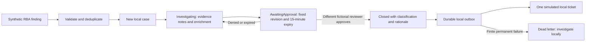

# Local SOAR and case-management operations

SentinelOps includes executable, dependency-free Python orchestration for the
fictional **Atlas Financial** customer. Its input is the existing RBA engine's
explicitly synthetic finding. Its output is a durable local case, structured
investigation notes, a reviewer decision, a justified classification and one
simulated service ticket. It has **no Azure, SaaS, network or containment
adapter**. A local case is not a Microsoft Sentinel incident.

## Run and inspect

From the repository root with Python 3.12+:

```powershell
python -m rba
python -m soar
python -m soar --risk-report .local/rba/report.json --output .local/soar
python -m unittest discover -s tests -p test_soar.py -v
```

The CLI accepts a bounded synthetic RBA JSON report of at most 512 KiB with
exactly one finding, matching the default scenario. The Python case-store API
can intake up to 32 findings transactionally. It does not accept live incidents,
arbitrary REST bodies, scripts or remote connector URLs. If the CLI rejects a
conflicting finding or state, preserve its database for investigation rather
than deleting it to force a successful replay.

| File under the selected output directory | Purpose |
|---|---|
| `case-store.sqlite3` | Durable cases, notes, decisions, outbox, tickets and chained audit |
| `report.synthetic.json` | Full demonstration and six bounded failure scenarios |
| `cases.synthetic.json` | Original finding, entities, enrichment, case state and decision history |
| `audit.synthetic.json` | Ordered audit sequence, previous/entry hashes and operation details |
| `README.md` | Short execution summary and explicit synthetic boundary |

All default outputs live in ignored `.local/soar/`. The same input against the
same database does not duplicate a case, note, ticket or successful audit event.
Exports are recomputed from persisted state. Use a **new local output directory**
for a separate fictional exercise; never reset an actual cloud pilot ledger.

## Workflow and data lineage



`soar.store.CaseStore(path, clock=...)` is the orchestration API. Its context
manager closes the SQLite connection; the optional clock is injected for
reproducible tests. `intake_report(report)` returns deterministic `lab-case-*`
IDs derived from finding IDs. An exact repeat returns the existing IDs; a
changed body with the same finding ID fails atomically without overwriting the
original. SQLite unique constraints and `BEGIN IMMEDIATE` serialize concurrent
intake. A failed audit insert rolls the whole case transaction back.

Input validation enforces synthetic identifiers, finite risk scores, existing
AF-RBA-001 shape and technique catalog, explicit synthetic event markers,
original source-event IDs, strict event ordering, same-account identity and
host/resource joins. The seven contributing source events remain embedded in
the case; normalization does not replace their original IDs. This is boundary
validation of an existing finding, not a second RBA scoring implementation.
The original confidence/health limitations are preserved. Local enrichment
adds fictional customer ownership, canonical related entities and existing
investigation steps; it neither raises confidence nor invents threat-intel hits.

## Case state and decision gates

1. `investigate(case_id)` changes New to Investigating.
2. `add_note(case_id, text, category)` accepts investigation, evidence or
   recommendation notes while Investigating. Notes are bounded to 2,000
   characters, reject invalid controls and deduplicate exact repeats.
3. `request_closure(case_id, classification, rationale)` requires at least one
   evidence note, captures a specific revision and freezes mutable evidence.
4. `decide(approval_id, approved, comment)` requires the separate reviewer
   role, matching current case/revision, a pending decision and an unexpired
   15-minute window. Approval closes the case; denial/expiry returns it to
   Investigating. An approval is consumed once and cannot be reused.

Allowed classifications are BenignPositive, FalsePositive, TruePositive and
Undetermined. Classification always needs rationale; the demo closes as
**BenignPositive** because it matches an intentionally generated fictional
exercise. It does not allege a real compromise or measure false-positive rates.
Closed cases cannot be silently reopened through this API. A new workflow for
reopening would need a separate explicit transition and tests.

The actor catalog contains `lab-analyst` and `lab-reviewer`. These are **local
simulation roles, not authenticated people**. The CLI performs a clearly
fictional reviewer decision; it does not claim a human approved it. Production
use would require authenticated identity, authorization, separation of duties,
tamper-resistant storage and actual approval delivery. A case approval never
authorizes Azure changes, account blocking or resource deletion.

## Retry, timeout and consistency model

`deliver_ticket(case_id, scenario)` has four finite, local-only scenarios:
available, transient, timeout and permanent. A transient first attempt recovers
on attempt two; timeout exhausts three attempts and dead-letters; permanent
failure stops after attempt one. A successful or dead-lettered task cannot
reset its retry budget by being called again or by reopening the database.

Each logical attempt records a two-second deadline and bounded backoff of
0 / 0.25 / 0.5 seconds. These are **deterministic simulations**: no sleeping,
HTTP request or wall-clock remote timeout occurs. They demonstrate the state
and operational response to failures, not a verified network transport. The
payload's stable hash and unique case/ticket constraints prevent duplicate
local tickets. The simulated outbox, ticket and audit update share one SQLite
transaction. A real remote connector would also need an idempotency key,
deadline enforcement, accepted-but-disconnected reconciliation and durable
attempt reservation; this local implementation does not claim those remote
delivery guarantees.

## Audit and storage

Every mutation records actor, action, UTC time, case, details, previous hash
and SHA-256 entry hash. SQLite triggers reject audit UPDATE/DELETE. Startup and
each mutation verify the chain; ordinary corruption fails closed. Chaining is
**not a digital signature**, trusted timestamp or protection against an operator
with write access to the entire database who can rebuild the chain or drop
triggers. Out-of-band case edits are also outside its trust model; a stale
revision still invalidates a pending approval. Treat the database as private
local state, not a hardened service.

The connection uses foreign keys, WAL, FULL synchronous commits and a five-second
busy timeout. There are limits of 1,000 cases, 200 notes per case and 50,000 audit
events. Do not copy an actively written SQLite database without its consistency
requirements: close the store and use SQLite backup tooling for operational
backups. Do not commit local databases or WAL files. Only reviewed synthetic
JSON exports are suitable as public evidence.

## Failure handling and recovery

| Observation | Action |
|---|---|
| Conflicting replay | Compare finding fingerprints and original lineage; retain prior case; do not overwrite |
| AwaitingApproval | Inspect pending revision/expiry and use the distinct fictional reviewer; no evidence edits |
| Expired/denied | Investigate further and request a new revision-bound decision |
| Dead-lettered ticket | Inspect audit reason/attempts; preserve retry budget and create a separately reviewed repair strategy |
| Audit chain mismatch | Stop mutations; preserve database and compare trusted backup/export; never rebuild hashes merely to clear the error |
| SQLite busy | Stop concurrent writer and retry once manually; the store does not spin indefinitely |
| Invalid/non-synthetic input | Reject before intake; no live adapter is available |

Azure automation rules and Logic Apps remain alternatives for future deployment,
not requirements for this local workflow. They would add permissions, resource
lifecycle, trigger/run costs and remote failure modes. No Logic App or automation
rule is deployed for this feature, and the remaining trial credit is not treated
as permission to start a recurring workload. The [validation record](../validation/phase-5.md)
records the actual local acceptance and its live-cloud limitations.
