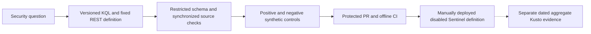
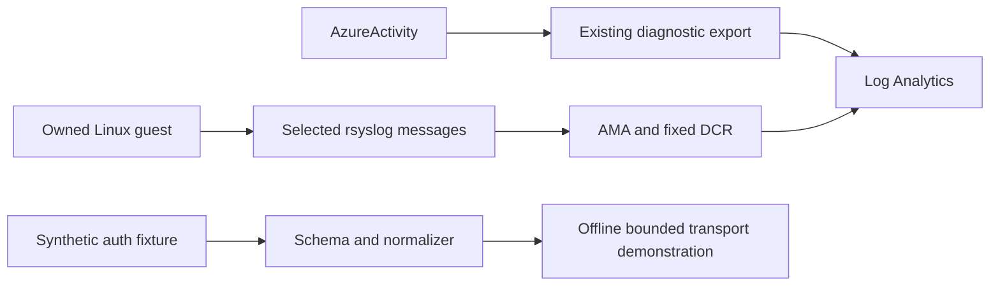
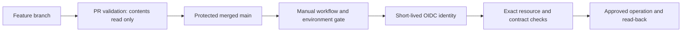
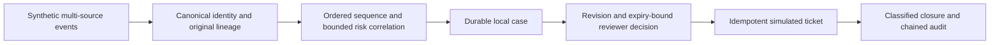

# Review route: from telemetry to a defensible finding

[Overview](../../README.md) · [Architecture](../architecture/overview.md)
· [Demonstration](demo-five-minutes.md) · [Decisions](engineering-decisions.md)
· [Security](../security.md) · [Acceptance](../validation/project-completion.md)

## Start with the implemented system

Run `python -m lab --bundle` from the repository root with Python 3.12+ and open
`.local/lab/index.html`. This replay is offline and synthetic. Historical cloud
records are displayed as dated records, not generated by the replay.

The [end-to-end architecture](../architecture/overview.md) is the system map.
These smaller diagrams explain the boundaries that matter when reviewing it.

## Detection lifecycle

Inspect [the catalog](../detections/portfolio.md),
[actual KQL](../../detections/azure/) and [validation](../validation/detection-portfolio.md).
Offline controls test the Python contract and simulations; they do not execute Kusto.
Disabled rules provide no active monitoring. The isolated real-scheduler test
is documented separately in [the lifecycle record](../validation/lifecycle.md).

## Telemetry ingestion

The [AMA pilot](../validation/local-linux-ama.md) is a completed historical
observation; the guest remains stopped. The synthetic authentication path
does not imply a deployed custom ingestion table. Read
[evidence handling](../evidence-handling.md) before extracting any artifact.

## Deployment security

OIDC avoids a stored client secret; fixed resource contracts constrain the
identity's usable operation surface. The [security design](../security.md)
and [recovery guide](../deployment/recovery.md) explain failure behavior.
Documentation PRs execute offline validation and do not deploy to Azure.
Do not change permissions or rearm completed gates to demonstrate this diagram.

## Investigation and controlled response

Read the [risk design](../operations/risk-correlation.md) and
[SOAR behavior](../operations/soar.md). The local case is not the real Sentinel
test incident. Local roles and connectors are simulations; risk scores are not
calibrated probabilities. Source-health uncertainty stays separate from risk.

## Useful technical interview questions

| Question | Evidence to inspect |
| --- | --- |
| How are source events retained through correlation? | `rba/`, `soar/`, lineage and conflicting-replay tests in `tests/` |
| What happens to a stale approval or a retried action? | SOAR revision/expiry checks, persistent retry budgets and audit tests |
| Why separate health and risk? | Platform-health Unknown/maintenance handling and risk-control scenarios |
| What was actually deployed or queried? | Dated sanitized JSON under `evidence/` and final acceptance records |
| What remains unknown? | Unqueried IaC references, synthetic coverage limits and monetary-cost caveats in acceptance |

## Verification

Use [the root verification commands](../../README.md#verify-the-project) and
the required [offline workflow](../../.github/workflows/validate.yml).
The Bicep compiler check downloads a pinned official tool; it is separate from
the dependency-free replay. Passing offline tests is not a new cloud observation.
